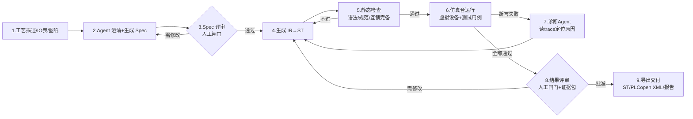

# 灵枢 NeuroAxis · 产品需求、品牌与验收

> 源文档：《15 灵枢 NeuroAxis 设计文档》第 0/1/11 章与附录。本文回答「做什么、给谁做、做到什么程度算成」。

**一句话定位：一个"从工艺描述到可运行 PLC 程序"的 AI 工程 Agent——它读需求、写程序、在虚拟设备上把程序跑通、自己找出错在哪并修好，最后交出人和测试证据，人才把程序下到真机。**

### 0.1 为什么现在做（三个现实）

1. **PLC 编程是瓶颈而非壁垒**：中小集成商一台设备 1~2 周编程调试，其中 60% 时间在做"标准件"——启停互锁、气缸时序、报警、手自动切换。这部分有明确的模式，可被生成。
2. **虚拟调试已是行业惯例**：西门子 PLCSIM、CODESYS Control Win、倍福 TC/Target 都有免费或低成本仿真运行时，"先仿真跑通再碰硬件"不需要说服客户。
3. **LLM 生成工业代码的最大障碍不是"写不出"，而是"不敢用"**：梯形图/ST 写错会撞坏设备。所以产品的核心竞争力不是生成能力，而是**验证能力**——仿真台 + 静态检查 + 证据链。这决定了架构：先建测试台，再接 LLM。

### 0.2 用户与两个付费场景

| 用户 | 痛点 | 愿意付钱的原因 |
|---|---|---|
| 小型自动化集成商（1~10 人） | 项目排队，编程人手不够 | 标准逻辑生成 + 仿真预调试，把 2 周现场调试压到 1 周 |
| 设备制造商（OEM） | 每台设备按配置出程序，改来改去 | 规格驱动生成：选配变化只改 Spec，程序重生成，测试回归自动跑 |
| 工厂电气工程师（自维护） | 看不懂老程序、不敢改 | 程序→Spec 反向解析 + 仿真验证后再下载 |

### 0.3 产品形态（一个内核，三种交付）

| 形态 | 载体 | 用途 |
|---|---|---|
| Studio 桌面端 | WPF（复用 13 号平台客户端骨架） | 工程师日常：写 Spec、看生成、盯仿真、审批下载 |
| 无头 CLI | `plcagent` dotnet tool | CI/回归：`plcagent verify --project p1 --baseline golden` |
| 服务端（可选） | ASP.NET Core + PostgreSQL | 团队共享工程库、审批留痕、知识库集中管理 |

**P0 只做 Studio + CLI，服务端 P1 再上**——一个人先跑通闭环，别一上来做多人协作。

### 0.4 与 13 号平台的关系（不重复造轮子）

本产品定位为 13 号平台的一个**能力插件**（`kind: Copilot`），复用其：设备驱动插件（02 号驱动契约）、WPF 客户端框架、RBAC/审计、日志体系。本产品自己新增的内核只有四块：

```
[Spec/IR 引擎] [ST 生成与检查] [仿真台(软PLC+虚拟设备)] [Agent 编排]
```

所以本文档只详设这四块 + 它们对 13 号契约的挂接点；登录、权限码、审计哈希链等直接引用 13 号 9 章的结论，不重写。

---

---

### 1.1 核心闭环（产品的灵魂，一切设计围绕它）



**三条铁律**（写进所有 Prompt 和代码注释的第一行）：

1. **LLM 永远不直接产出交付物**。它产出结构化 IR（JSON），IR 经确定性代码生成器变成 ST。人看到并审批的是 Spec 和 Diff，不是聊天记录。
2. **仿真台是测试台，不是演示**。每个生成结果必须过"五道闸门"（定义见 14.1），闸门全自动化、不可跳过、结果不可被 Agent 修改。
3. **真机写入永远人工闸门**。Agent 的权限边界是"仿真环境内为所欲为，仿真环境外一字节都写不进去"（四阶段推进见 10.2）。

### 1.2 范围定义

**做（P0/P1）**：

| # | 能力 | 期 |
|---|---|---|
| F1 | Spec 工程：YAML 定义 IO 表、设备、状态机、互锁、报警、配方 | P0 |
| F2 | IR→ST 确定性代码生成（含手自动、急停、互锁标准模板） | P0 |
| F3 | ST 子集静态检查：语法、类型、命名、双重赋值、扫描超时预估 | P0 |
| F4 | 仿真台：确定性软 PLC（10ms 扫描）+ 虚拟设备库（≥12 种元件） | P0 |
| F5 | 测试 DSL + 断言 + 覆盖率 + trace 回放 | P0 |
| F6 | Agent 闭环：Spec 生成→代码→仿真→诊断→修复（≤5 轮自动收敛） | P0 |
| F7 | 虚拟 HMI：用 Spec 自动生成操作画面（启动/停止/手自动/报警列表） | P1 |
| F8 | 厂商导出：ST 源码 + PLCopen XML（CODESYS/TwinCAT 可导入） | P1 |
| F9 | 真机对接：Modbus TCP 读写验证 + S7（PUT/GET 只读影子模式） | P1 |
| F10 | 反向解析：导入 ST→推测 IR→生成 Spec 草稿（看懂老程序） | P2 |
| F11 | 知识库 RAG：厂商手册/标准/历史项目检索，带引用回链 | P2 |
| F12 | 多品牌方言：SCL（西门子）/三菱 ST/汇川 输出适配 | P2 |

**明确不做**（每一项都是范围失控的源头）：

1. 不做安全功能生成——急停、安全门、光幕必须走安全 PLC/安全继电器，本产品生成的互锁只是"生产可用性控制"（沿用 13 号 1.3 第 7 条口径，合同里不得写"保证安全"）。
2. 不做梯形图/LD 图形化生成与渲染（P2 只读渲染评估）——图形布局是独立的大工程，ST + PLCopen XML 已可交付。
3. 不做实时性能承诺——生成的程序运行在目标 PLC 上，扫描周期实测由仿真台给出预估值（±20%），真机以厂商工具实测为准。
4. 不做视觉/机器人/运动控制卡的程序生成（运动卡见 03 号、视觉见 04 号，各有自己的工具链）。
5. 不做设备选型与电气设计（EPLAN 的活）。

### 1.3 量化验收指标（P0 结束时拿这张表打分）

| 指标 | 目标值 | 测量方法 |
|---|---|---|
| D1 样例从空工程到仿真全绿 | ≤ 30 min（含人工评审等待） | 计时脚本 |
| Spec→ST 首次生成编译通过率 | ≥ 90%（评测集 20 题） | 评测脚本统计 |
| 仿真断言全过率（≤5 轮修复内） | ≥ 95% | 同上 |
| 修复轮次中位数 | ≤ 2 | 同上 |
| 仿真速度 | ≥ 20× 实时（D1 规模 32 IO） | 虚拟时钟 vs 墙钟 |
| 扫描确定性 | 同输入 1000 次运行 trace 逐字节一致 | 哈希对比 |
| 互锁完备性检查 | 人为删除一条互锁后，静态检查必须报错 | 故障注入测试 |
| 单项目 Agent 成本 | ≤ ¥5（国产模型）或 ≤ $1（云模型） | token 计量 |
| 端到端延迟（不含人工） | ≤ 10 min | 计时 |

> 这张表 P0 期间每周五跑一次全量，数字退化就停下修，不往前走。

### 1.4 关键架构决策（ADR）

| # | 决策 | 理由 | 放弃的方案 | 代价 |
|---|---|---|---|---|
| A1 | LLM 产出 IR（JSON），IR→ST 由确定性模板生成 | 消除语法幻觉；IR 可校验、可 diff、可回归 | LLM 直写 ST | 表达力受限，遇超出 IR 的逻辑走"表达式块"逃生舱（仍受静态检查约束） |
| A2 | 自研 ST 子集解释器做仿真执行 | 确定性可控、可插桩（覆盖率/trace）、零外部依赖 | 直接用 OpenPLC/matIEC 编译执行 | 需实现 ~30 个标准 FB；子集外指令不支持 |
| A3 | ST 子集 + 逃生舱架构 | 解释器只需覆盖子集；子集覆盖 80% 常规逻辑 | 全量 IEC 61131-3 | 少数复杂算法（如模糊控制）P2 再议 |
| A4 | 仿真与真机同一份 Spec 驱动 | IO 映射一处定义，仿真与导出共用 | 仿真单独配 | Spec 设计要一次到位 |
| A5 | 厂商落地分 A/B/C 三档（见 7 章） | 诚实面对厂商工具链封闭现实 | 承诺全自动下载 | 高档目标需要厂商许可/在场工具 |
| A6 | 知识库分三层：规范库/厂商库/项目库，检索必带引用 | 防幻觉、可审计 | 无引用自由生成 | 维护成本 |
| A7 | P0 单机、P1 才上服务端 | 先验证闭环价值 | 一开始微服务 | 后续重构成本可控（模块边界已按服务切） |
| A8 | 许可证红线：不静态链接任何 GPL 运行时 | 商用前提 | 嵌 OpenPLC | matIEC 以外部进程调用（LGPL 边界，见 7 章末） |
| A9 | Agent 编排双轨：P0 自研 C# 状态机；P1 引入 LangGraph（Python Worker）承载 Debug 归因图，语义对齐后可切换 | 自研闭环快且可控；LangGraph 的 checkpoint/中断恢复/图可视化是 P1 多角色协作的刚需，自研到 P1 会重复造轮子且难对齐 | 全自研到底 / 一开始就上 LangGraph | 双轨维护成本 → 用"等价回归集"约束切换（19.4），配置开关可回退 |

---

---

| 期 | 周期 | 交付 | 退出条件 |
|---|---|---|---|
| P0 垂直切片 | 6 周 | D1 全闭环（Spec→IR→ST→仿真→诊断修复→证据包） | 1.3 表全绿；确定性 1000 次通过 |
| P1 工程化 | 8 周 | 虚拟HMI、PLCopen XML、S7影子模式、多任务解释器、服务端多人、**RAG 知识库（19.1~19.3）+ LangGraph Worker（19.4）** | B 档导出 TIA 导入编译通过；双闸门 RBAC；RAG recall@5≥0.8；等价回归通过后引擎切换 |
| P2 生态 | 10 周 | 反向解析、RAG 知识库、三方言导出、评测集 50 题 | 评测集 pass@5≥85%；老程序解析可用率≥70% |

人力参考：1 名 C#（平台+客户端）、1 名控制/仿真（元件库+解释器）、0.5 名 AI 应用（Agent/评测）可完成 P0；P1 起加 1 名前端。

**P0 验收清单（14 条）**：①D1 空工程到全绿 ≤30min；②首过编译率≥90%（20题）；③5轮内全绿率≥95%；④确定性 1000 次全等；⑤删互锁必报错（V3）；⑥trace 回放与原运行一致；⑦断电重启恢复 run 状态；⑧SimHost 强杀不丢 Studio；⑨全部 LLM 调用有记账；⑩证据包含声明+覆盖率+波形+审批；⑪CLI 可 CI 跑回归；⑫方言导出 ST 过 matIEC 编译；⑬超预算熔断；⑭审计链完整（谁在何时批了什么）。

---

**结论：本产品的 11~19 章只覆盖了「软件做出来」；一旦独立对外收费，还必须过四道门——装得上（交付物可信）、有存量（割接）、有人伺候（SLA）、有报价（回款）。13 号在 v1.5 用 12.10~12.13 与 13.2.2 补齐了这四块，本产品独立交付时直接沿用其口径，不重写，只声明挂接点。**

| 缺口（13 号编号） | 本产品的挂接口径 | 交付前检查项 |
|---|---|---|
| C4 交付物可信（13 号 12.11） | `plcagent` dotnet tool、Studio 安装包、SimHost 子进程 exe **全部 Authenticode 签名 + RFC3161 时间戳**；离线包附 SBOM（SPDX/CycloneDX）。特别注意：matIEC 二进制随包分发前须书面确认 LGPL 义务已满足（源码可获取路径写入交付物），QuestPDF 商用许可核对社区版边界 | 干净机（含甲方同款 EDR）双击即装；`plcagent --version` 验签通过 |
| C5 存量替换（13 号 12.12） | 本产品常与既有 PLC 程序共存：F10 反向解析前，先用影子模式只读对拍（10.2 阶段 1）替代「直接接管」；**谁拥有 PLC 写权限**是进场判型第一问，未交权前产品只做只读分析 | 首次进场登记表含「现有程序归属与写权限状态」 |
| C6 运维 SLA（13 号 12.13） | 评测集退化、LLM 供应商涨价/停服、本地模型显存不足是运维期三大高频项；SLA 分级与远程支持边界沿用 13 号 P1~P4 分级；云通道故障的恢复目标写「降级到本地模型/规则引擎」，不写「不可用」 | 质保条款含模型供应商变更预案 |
| C7 报价与回款（13 号 13.2.2） | 报价六项拆分：License（Studio 席位）/ 评测集定制（客户专用工艺题）/ 方言导出适配（按厂商单列）/ 知识库摄取（按手册页数）/ 年度维护 / 训练。**评测集与知识库是本产品独有的可计费项**，别免费送 | 合同含回款节点与「按 A/B/C 档交付」的验收口径 |

**一句话**：13 号 13.7.3 的结论对本产品同样成立——「文档写到了」不等于「能力有了」；本产品上线前先跑通 D1 全闭环（M0 等价物），再把 20 章这张表逐行勾掉。

---

## 附录 A：D1 样例工程目录

```
demo-d1/
  spec.yaml            # 3.2 全文
  expected/            # 黄金基线
    trace_normal_cycle.parquet
    report.pdf
  tests/suite.yaml     # 5.4 用例
  plant/params.yaml    # 元件参数(行程ms等)
```

跑通命令：

```bash
plcagent new demo-d1 --template conveyor_sorting
plcagent edit demo-d1/spec.yaml          # 或 Studio
plcagent run demo-d1 --kind generate     # 全闭环
plcagent verify demo-d1 --baseline expected/   # CI 回归
```

## 附录 B：术语

| 术语 | 含义 |
|---|---|
| Spec / IR / ST | 人写的工艺规格 / 中间表示 / IEC 61131-3 结构化文本 |
| trace | 一次仿真的逐扫描信号与插桩记录 |
| 闸门 Gate | 人工或自动的通过点（Gate_Spec / Gate_Result） |
| 影子模式 | 只读采集真机 IO 与仿真对拍，不写 |
| A/B/C 档 | 厂商落地三档（7 章） |

## 附录 C：参考

- IEC 61131-3:2013 / IEC 61131-10（PLCopen XML）
- [OpenPLC（GPLv3，仅作 A 档运行时参考）](https://github.com/thiagoralves/OpenPLC)
- [matIEC（LGPL，iec2c 编译器）](https://github.com/beremiz/matiec)
- [Beremiz（开源 IEC IDE 架构参考）](https://industrialmonitordirect.com/blogs/knowledgebase/beremiz-open-source-iec-61131-3-ide-project-status-and-alternatives)
- [NModbus（MIT）](https://www.nuget.org/packages/NModbus)、[S7NetPlus（MIT）](https://github.com/S7NetPlus/s7netplus)
- [TIA Portal Openness（B 档依赖，需本机 TIA）](https://cloud.tencent.com/developer/article/2702029)
- 手册内：[13 平台](13_插件化工业软件平台_技术架构与二次开发方案.md)（复用契约）、[02 通信](02_下位机通信实战.md)（驱动与模拟器）、[09 加药](09_项目设计说明书_污水加药联动系统.md)（PID 闭环样例可做 D3）

## 附录 D：外部契约摘录清单（`docs/contracts/` 待补，P0 并行轨道）

本产品大量引用"13 号平台"的结论但不重写。拆分后原文档不在本仓库，为使实施者可独立开工，P0 期间将以下契约**摘录**（非全文复制，只摘本产品挂接用到的接口定义）到 `docs/contracts/`：

| 待摘文件 | 摘录内容 | 消费方 |
|---|---|---|
| `contracts/13-plugin-manifest.md` | `kind: Copilot` 插件 manifest 格式与加载约定 | Studio 挂接（0.4） |
| `contracts/13-rbac-audit.md` | 9 章 RBAC 权限码表 + 9.7 审计哈希链字段定义 | 双人复核（4.6）、审批链（P1-⑤） |
| `contracts/02-driver-contract.md` | 驱动契约接口（Modbus/S7 驱动如何注册） | F9 真机对接 |
| `contracts/13-write-four-gates.md` | 5.6 写四闸定义 | 真机写入四阶段（10.2） |

每份摘录文件头部必须注明来源文档编号与章节、摘录日期、原文是否可能演进（演进时由谁同步）。拿不到原文时的降级口径见《03_实施计划》第 4 节。

---
