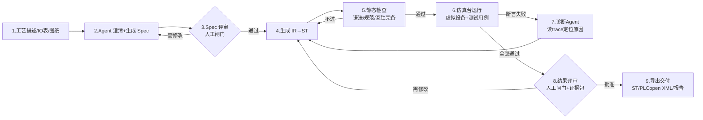

# 1. 产品定义与核心闭环

### 1.1 核心闭环（产品的灵魂，一切设计围绕它）

**三条铁律**（写进所有 Prompt 和代码注释的第一行）：

1. **LLM 永远不直接产出交付物**。它产出结构化 IR（JSON），IR 经确定性代码生成器变成 ST。人看到并审批的是 Spec 和 Diff，不是聊天记录。
2. **仿真台是测试台，不是演示**。每个生成结果必须过"五道闸门"（定义见 14.1），闸门全自动化、不可跳过、结果不可被 Agent 修改。
3. **真机写入永远人工闸门**。Agent 的权限边界是"仿真环境内为所欲为，仿真环境外一字节都写不进去"（四阶段推进见 10.2）。

### 1.1a 产品形态（一个内核，三种交付）

| 形态 | 载体 | 用途 |
|---|---|---|
| Web 工作台 | Vue 3 前端 + FastAPI（浏览器访问） | 工程师日常：写 Spec、看生成、盯仿真、审批下载、知识库问答、错误排查 |
| 无头 CLI | `plcagent` Python CLI | CI/回归：`plcagent verify --project p1 --baseline golden` |
| 服务端 | FastAPI + LangGraph + PostgreSQL（P0 即启用） | 工程库、审批留痕、知识库；多人协作与权限隔离 P1 细化 |

**P0 只做 Web + CLI**（同进程托管，数据落 PG）——浏览器直接用，不装客户端。

### 1.2 范围定义

**做（P0/P1）**：

| # | 能力 | 期 |
|---|---|---|
| F1 | Spec 工程：YAML 定义 IO 表、设备、状态机、互锁、报警、配方 | P0 |
| F2 | IR→ST 确定性代码生成（含手自动、急停、互锁标准模板） | P0 |
| F3 | ST 子集静态检查：语法、类型、命名、双重赋值、扫描超时预估 | P0 |
| F4 | 仿真台：确定性软 PLC（10ms 扫描）+ 虚拟设备库（≥30 种元件，四大族覆盖离散/过程常见设备） | P0 |
| F5 | 测试 DSL + 断言 + 覆盖率 + trace 回放 | P0 |
| F6 | Agent 闭环：Spec 生成→代码→仿真→诊断→修复（≤5 轮自动收敛） | P0 |
| F7 | 虚拟 HMI：用 Spec 自动生成操作画面（启动/停止/手自动/报警列表） | P1 |
| F8 | 厂商导出：ST 源码 + PLCopen XML（CODESYS/TwinCAT 可导入） | P1 |
| F9 | 真机对接：Modbus TCP 读写验证 + S7（PUT/GET 只读影子模式） | P1 |
| F10 | 反向解析：导入 ST→推测 IR→生成 Spec 草稿（看懂老程序） | P2 |
| F11 | 知识库 RAG：厂商手册/标准/历史项目检索，带引用回链 | P2 |
| F12 | 多品牌方言：SCL（西门子）/三菱 ST/汇川 输出适配 | P2 |

**明确不做**（每一项都是范围失控的源头）：

1. 不做安全功能生成——急停、安全门、光幕必须走安全 PLC/安全继电器，本产品生成的互锁只是"生产可用性控制"（沿用 13 号 1.3 第 7 条口径，合同里不得写"保证安全"）。
2. 不做梯形图/LD 图形化生成与渲染（P2 只读渲染评估）——图形布局是独立的大工程，ST + PLCopen XML 已可交付。
3. 不做实时性能承诺——生成的程序运行在目标 PLC 上，扫描周期实测由仿真台给出预估值（±20%），真机以厂商工具实测为准。
4. 不做视觉/机器人/运动控制卡的程序生成（运动卡见 03 号、视觉见 04 号，各有自己的工具链）。
5. 不做设备选型与电气设计（EPLAN 的活）。

### 1.3 量化验收指标（P0 结束时拿这张表打分）

| 指标 | 目标值 | 测量方法 |
|---|---|---|
| D1 样例从空工程到仿真全绿 | ≤ 30 min（含人工评审等待） | 计时脚本 |
| Spec→ST 首次生成编译通过率 | ≥ 90%（评测集 20 题） | 评测脚本统计 |
| 仿真断言全过率（≤5 轮修复内） | ≥ 95% | 同上 |
| 修复轮次中位数 | ≤ 2 | 同上 |
| 仿真速度 | ≥ 20× 实时（D1 规模 32 IO） | 虚拟时钟 vs 墙钟 |
| 扫描确定性 | 同输入 1000 次运行 trace 逐字节一致 | 哈希对比 |
| 互锁完备性检查 | 人为删除一条互锁后，静态检查必须报错 | 故障注入测试 |
| 单项目 Agent 成本 | ≤ ¥5（国产模型）或 ≤ $1（云模型） | token 计量 |
| 端到端延迟（不含人工） | ≤ 10 min | 计时 |

> 这张表 P0 期间每周五跑一次全量，数字退化就停下修，不往前走。

### 1.4 关键架构决策（ADR）

| # | 决策 | 理由 | 放弃的方案 | 代价 |
|---|---|---|---|---|
| A1 | LLM 产出 IR（JSON），IR→ST 由确定性模板生成 | 消除语法幻觉；IR 可校验、可 diff、可回归 | LLM 直写 ST | 表达力受限，遇超出 IR 的逻辑走"表达式块"逃生舱（仍受静态检查约束） |
| A2 | 自研 ST 子集解释器做仿真执行 | 确定性可控、可插桩（覆盖率/trace）、零外部依赖 | 直接用 OpenPLC/matIEC 编译执行 | 需实现 ~30 个标准 FB；子集外指令不支持 |
| A3 | ST 子集 + 逃生舱架构 | 解释器只需覆盖子集；子集覆盖 80% 常规逻辑 | 全量 IEC 61131-3 | 少数复杂算法（如模糊控制）P2 再议 |
| A4 | 仿真与真机同一份 Spec 驱动 | IO 映射一处定义，仿真与导出共用 | 仿真单独配 | Spec 设计要一次到位 |
| A5 | 厂商落地分 A/B/C 三档（见 7 章） | 诚实面对厂商工具链封闭现实 | 承诺全自动下载 | 高档目标需要厂商许可/在场工具 |
| A6 | 知识库分三层：规范库/厂商库/项目库，检索必带引用 | 防幻觉、可审计 | 无引用自由生成 | 维护成本 |
| A7 | P0 单机、P1 才上服务端 | 先验证闭环价值 | 一开始微服务 | 后续重构成本可控（模块边界已按服务切） |
| A8 | 许可证红线：不静态链接任何 GPL 运行时 | 商用前提 | 嵌 OpenPLC | matIEC 以外部进程调用（LGPL 边界，见 7 章末） |
| A9 | Agent 编排采用 LangGraph（Python 主栈）：checkpoint、interrupt 人闸、Debug 归因/知识库问答/排障子图同图承载 | checkpoint/中断恢复/图可视化与 4.2 状态机语义同构，自研到 P1 会重复造轮子且难对齐 | 全自研到底 / 一开始就上 LangGraph | 双轨维护成本 → 用"等价回归集"约束切换（19.4），配置开关可回退 |

---
