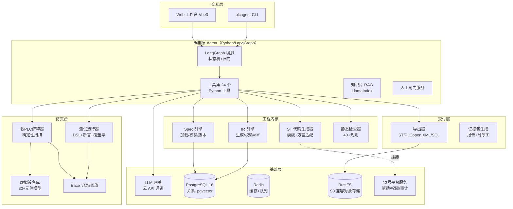
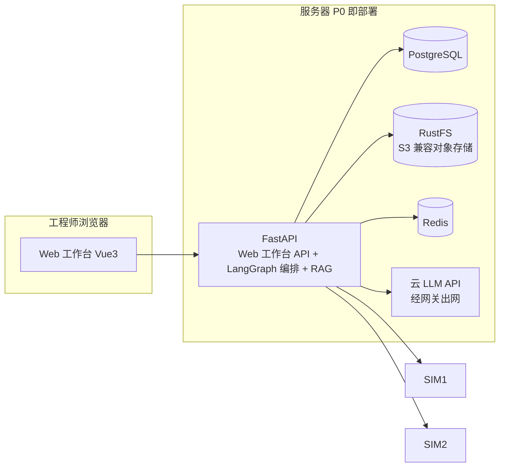
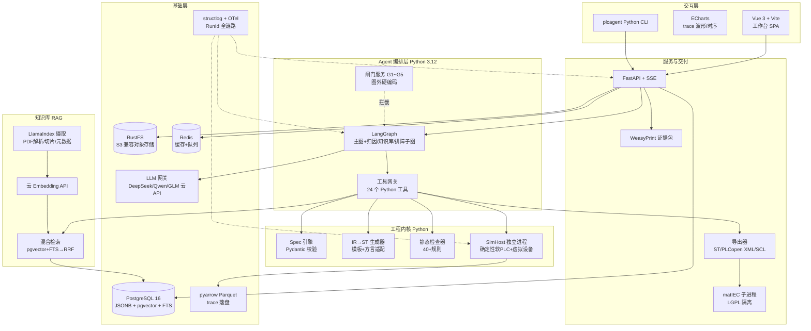

# 2. 总体架构

### 2.1 分层架构

### 2.2 运行时组件与进程模型

| 组件 | 进程 | 职责 | 关键约束 |
|---|---|---|---|
| Web 工作台 / CLI | 前台（FastAPI 托管，浏览器访问） | 交互、发起任务、展示 | 浏览器不直连 DB；CLI 仅访问本机 API |
| Orchestrator | Python 服务（LangGraph 图） | Agent 状态机、闸门、重试 | 一次任务一个 RunId，全链路打点；G1~G5 闸门在图外硬编码 |
| SimHost | 独立进程（可多实例） | 软 PLC + 虚拟设备 + 测试 | 崩溃不影响 Web/API；确定性执行 |
| LlmGateway | 同进程（Python） | 请求编排、限流、成本记账、脱敏 | 云供应商多通道可切（改 base_url）；出网默认脱敏 |
| RAG Pipeline | 同进程（LlamaIndex） | 文档解析/切片/嵌入/索引 | 检索走自有 pgvector 栈；引用回链强制 |
| Exporter | 按需子进程 | matIEC 调用（LGPL 边界） | 独立进程、独立目录、不留驻 |

**进程隔离的理由**：软 PLC 跑的是机器生成的代码（哪怕在解释器里），SimHost 崩溃/卡死必须能被外部强杀重启而不丢 Web/API 状态；这也是后续扩容时的天然拆分线（A7）。

### 2.3 技术选型

| 能力 | 选型 | 版本 | 理由 | 替代 |
|---|---|---|---|---|
| 运行时 | Python 3.12 | 主技术栈 | Agent 生态（LangGraph/LlamaIndex）、AI 工程效率、评测脚本同栈 | — |
| Web 前端 | Vue 3 + Vite（TypeScript） | 3.x | 平台化前端需要组件生态（表格/波形/流程图）；SSE 消费简单 | React |
| 服务端 | FastAPI + SSE | 0.115+ | 异步原生、Pydantic 双向校验（与 LLM JSON Schema 同构）、SSE 一等公民；自动 OpenAPI | Flask/Django |
| 可观测 | structlog + OpenTelemetry（run 全链路，RunId 为 trace 根） | — | 16.3 错误码体系需要链路追踪支撑，否则排障全靠翻日志 | — |
| 主库 | PostgreSQL 16（关系 + pgvector） | 16 | JSONB 存 Spec/IR，分区存 trace 摘要，pgvector 存知识库向量——一库三用；P0 即启用 | — |
| 对象存储 | RustFS（S3 兼容，boto3 客户端） | — | trace Parquet/证据包/导出产物落对象存储；S3 API 标准，未来可无感切换 MinIO/Ceph/云 S3；Rust 单二进制低内存 | MinIO（AGPL 商用注意）/ 云 S3 |
| 缓存&队列 | Redis 7 | 7.x | SSE 事件总线（多实例推送）、任务队列（Arq）、闸门通知、评测集调度锁 | NATS JetStream（P2 多机再评估） |
| ST 解析 | Python 自研递归下降（Antlr4-Python 备选） | — | 需要精确错误位置与插桩钩子 | — |
| matIEC | 外部进程调用 iec2c | 0.5+ | 语法二次校验 + 参考编译 | 不集成（P0 可不装） |
| PLCopen XML | 自研序列化 | TC6 v2.0 | CODESYS/TwinCAT 互通 | — |
| Modbus | pymodbus（BSD） | 3.x | Python 原生；client/server 双端（server 端做虚拟从站对拍） | — |
| S7 | python-snap7（snap7 C 库经子进程隔离，LGPL 边界同 matIEC 口径） | 1.x | 只读影子模式 | — |
| LLM | 云供应商 API（DeepSeek/Qwen/GLM 等，OpenAI 兼容协议统一网关，多供应商可切换） | — | 不自建本地模型：无 GPU 投入、无模型运维；结构化输出用 API 端 JSON Schema 强约束（勿依赖提示词） | 本地 vLLM（P2 再评估，仅当客户强要求离线） |
| RAG 检索 | pgvector（PG 16 内）+ PostgreSQL FTS（BM25 近似）混合，RRF 融合；embedding 用云 API（模型版本记元数据） | — | 不新增独立向量库，运维面最小；混合检索对术语型查询（"TON 语义"）强于纯向量 | Milvus/Qdrant（语料 >百万片再上） |
| 重排 | LLM listwise（P2） | — | 检索质量主要瓶颈在切片与查询改写，不在重排模型 | 云 reranker API |
| Agent 编排 | LangGraph | 0.2+（锁定版本） | checkpoint、interrupt 人闸、时间旅行回放与 4.2 状态机语义同构；Debug 归因/知识库问答/错误排障子图同图承载 | 自研状态机（agent.engine 回退开关） |
| 知识库摄取 | LlamaIndex（PDF 解析/切片/元数据抽取） | 0.11+（锁定版本） | K2 厂商手册解析/切片现成；检索/存储/引用回链走自有 pgvector 栈，不绑其索引闭包 | 纯自研解析（PDF/表格成本高） |
| trace 落盘 | pyarrow（Parquet） | 16+ | trace 记录/回放的事实标准，Python 生态原生 | — |
| 图表（前端） | ECharts | 5.x | trace 波形/时序图渲染，Vue 生态成熟 | Plotly |
| 报告 | WeasyPrint（HTML 模板→PDF） | — | 证据包 PDF；模板即 HTML，开发效率高 | ReportLab |

### 2.4 部署拓扑（P0/P1）

P0 最低配：一台 i5/16G 服务器（PG + RustFS + Redis + FastAPI/LangGraph + SimHost 同机）+ 云 LLM API Key；工程师浏览器访问，零客户端安装。

### 2.5 整体技术架构图（全景）

> **SVG 全景图**（更适合投屏/评审/嵌入交付物）：见 [`docs/architecture-overview.svg`](../architecture-overview.svg)——六层架构 + 闸门红线 + 知识库管线 + 基础层三件套 + 核心闭环一图总览。下方 mermaid 为同构源（维护以 mermaid 为准，SVG 由其派生）。

### 2.6 技术矩阵与合理性分析

| 层 | 技术 | 版本 | 许可 | 替代/逃生舱 | 合理性要点 |
|---|---|---|---|---|---|
| 运行时 | Python | 3.12 | PSF | — | AI 生态中心，LangGraph/LlamaIndex 原生同栈，评测脚本零胶水 |
| Agent 编排 | LangGraph | 0.2+ 锁定 | MIT | 自研状态机（agent.engine 开关） | checkpoint/interrupt 与闸门语义同构；回退开关兜底版本风险 |
| 知识库摄取 | LlamaIndex | 0.11+ 锁定 | MIT | 纯自研 PDF 解析 | 只用摄取段（解析/切片/元数据），检索自持，不绑索引闭包 |
| API | FastAPI + SSE | 0.115+ | MIT | Flask | 异步原生、Pydantic 与 LLM JSON Schema 同构、SSE 可 curl 调试 |
| 前端 | Vue 3 + Vite + ECharts | 3.x / 5.x | MIT | React + Plotly | 表格/波形/流程图组件生态成熟 |
| 向量库 | pgvector | 0.7+ | PostgreSQL License | Qdrant（语料>500万片时，19.1a） | 同库事务一致性 + 混合检索同 SQL + 零新增运维 |
| 主库 | PostgreSQL 16 | 16 | PostgreSQL License | — | JSONB 存 Spec/IR，分区表存 trace 摘要，一库三用 |
| 对象存储 | RustFS | — | Apache 2.0 | MinIO（注意 AGPL）/云 S3 | S3 兼容 API 标准客户端；Rust 单二进制低内存；Apache 2.0 无许可顾虑 |
| 缓存&队列 | Redis 7 | 7.x | RSALv2/SSPL（自建单机不受限） | NATS JetStream | 缓存/队列/发布订阅三合一；SSE 多实例必需 |
| 驱动 | pymodbus / python-snap7 | 3.x / 1.x | BSD / LGPL | — | Python 原生；snap7 子进程隔离 LGPL（同 matIEC 口径） |
| 编译校验 | matIEC（子进程） | 0.5+ | LGPL | 不集成（P0 可不装） | 独立进程/目录隔离 LGPL 边界 |
| trace | pyarrow (Parquet) | 16+ | Apache 2.0 | — | 列存回放事实标准，与评测脚本直连 |
| 证据包 | WeasyPrint | — | BSD | ReportLab | HTML 模板即报告版式，开发效率高 |
| 可观测 | structlog + OpenTelemetry | — | MIT / Apache | — | RunId 为 trace 根，支撑 16.3 错误码体系 |
| LLM | 云 API（DeepSeek/Qwen/GLM，OpenAI 兼容） | — | — | 本地 vLLM（P2 再评估） | JSON Schema 端强约束，多供应商可切，零 GPU 投入 |

**合理性总评**：15 项选型中 12 项宽松许可（MIT/BSD/PSF/Apache）；两个 LGPL 组件（matIEC、snap7）统一用「独立子进程」一种隔离模式，运维心智一致；每个关键组件都有回退开关或替代路径（LangGraph→自研、pgvector→Qdrant、RustFS→MinIO/云 S3、Redis→NATS、matIEC→不装），没有单点锁死。

---
