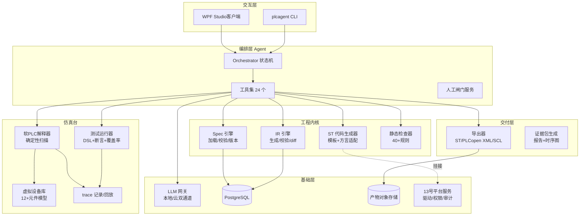
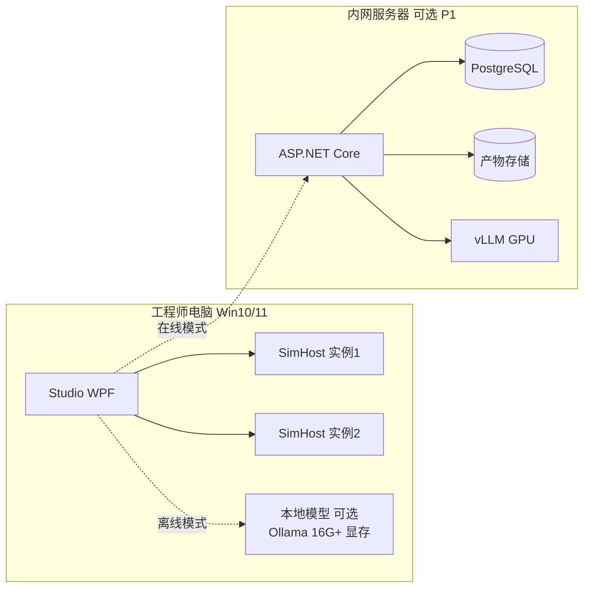

# 2. 总体架构

### 2.1 分层架构

### 2.2 运行时组件与进程模型

| 组件 | 进程 | 职责 | 关键约束 |
|---|---|---|---|
| Studio / CLI | 前台 | 交互、发起任务、展示 | 不直接碰 DB 以外的任何端口 |
| Orchestrator | 同进程后台 Host | Agent 状态机、闸门、重试 | 一次任务一个 RunId，全链路打点 |
| SimHost | 独立进程（可多实例） | 软 PLC + 虚拟设备 + 测试 | 崩溃不影响 Studio；确定性执行 |
| LangGraph Worker（P1） | Python 容器 | Debug 归因子图、checkpoint、interrupt | 无 DB 凭据/无文件写/无网络出口，仅 gRPC 回工具网关（19.4） |
| LlmGateway | 同进程 | 请求编排、限流、成本记账、脱敏 | 本地/云可切；云通道默认脱敏 |
| Exporter | 按需子进程 | matIEC 调用（LGPL 边界） | 独立进程、独立目录、不留驻 |

**进程隔离的理由**：软 PLC 跑的是机器生成的代码（哪怕在解释器里），SimHost 崩溃/卡死必须能被外部强杀重启而不丢 Studio 状态；这也是后续上服务端时的天然拆分线（A7）。

### 2.3 技术选型

| 能力 | 选型 | 版本 | 理由 | 替代 |
|---|---|---|---|---|
| 运行时 | .NET 8 | LTS | 与手册全系列一致 | — |
| 客户端 | WPF + CommunityToolkit.Mvvm | 8 | 复用 13 号骨架 | Avalonia（要跨 Linux 时） |
| 服务端 | ASP.NET Core Minimal API + SignalR | 8 | 实时推送仿真进度 | — |
| 主库 | PostgreSQL 16 | 16 | JSONB 存 Spec/IR，分区存 trace 摘要 | SQLite（单机 P0 降级可用） |
| ST 解析 | 自研递归下降（Antlr4 备选） | — | 需要精确错误位置与插桩钩子 | Antlr4（语法复杂后切换） |
| matIEC | 外部进程调用 iec2c | 0.5+ | 语法二次校验 + 参考编译 | 不集成（P0 可不装） |
| PLCopen XML | 自研序列化 | TC6 v2.0 | CODESYS/TwinCAT 互通 | — |
| Modbus | NModbus（MIT） | 3.x | 02 号已用，驱动契约兼容 | — |
| S7 | S7NetPlus（MIT） | 0.20 | 只读影子模式 | Snap7（LGPL，避免） |
| LLM | OpenAI 兼容协议统一网关 | — | 本地 vLLM/Ollama 与云同构 | — |
| 本地模型 | Qwen 系 32B 级 / DeepSeek 蒸馏，vLLM 部署 | — | 内网离线；工业现场数据不出厂 | 云 API |
| RAG 检索 | pgvector（PG 16 内）+ PostgreSQL FTS（BM25 近似）混合，RRF 融合；bge-m3 类本地 embedding | — | 不新增独立向量库，运维面最小；混合检索对术语型查询（"TON 语义"）强于纯向量 | Milvus/Qdrant（语料 >百万片再上） |
| 重排 | 本地 bge-reranker 或 LLM listwise（P2） | — | 检索质量主要瓶颈在切片与查询改写，不在重排模型 | — |
| Agent 框架（P1） | LangGraph（Python 3.12 Worker）承载 Debug 归因子图 | 0.2+ | checkpoint 持久化、中断恢复、时间旅行调试与 4.2 状态机语义同构 | Semantic Kernel（全 .NET）、自研扩展 |
| 索引框架 | LlamaIndex 仅作摄取侧 pipeline（文档解析/切片/元数据抽取） | — | 解析能力现成；检索/存储仍走自有 pgvector，不绑其索引闭包 | 自研解析（PDF/表格复杂时成本高） |
| 图表 | ScottPlot | 5 | trace 波形高性能渲染 | LiveCharts2 |
| 报告 | QuestPDF | 2024.x | 证据包 PDF | — |

### 2.4 部署拓扑（P0/P1）

P0 最低配：一台 i5/16G 无 GPU 电脑 + 云 API（或小参数本地模型）即可跑通 D1。

---
