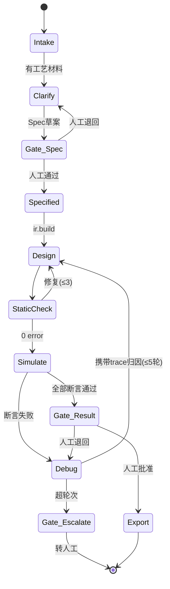

# 4. AI Agent 设计


### 4.1 角色与工具（不是聊天机器人，是流水线工人）

Agent 系统由 1 个编排器 + 6 个角色组成，每个角色只做一类事，工具权限各不相同：

| 角色 | 输入 | 输出 | 可用工具 | LLM 用途 |
|---|---|---|---|---|
| Clarifier | 工艺描述/图纸OCR/IO表 | Spec 草案 + 澄清问题列表 | io.infer, kb.search | 抽取 IO 表、设备、模式；**生成澄清问题**（缺急停/缺到位传感器必问） |
| Specifier | Spec 草案 + 人工答复 | 定稿 Spec | spec.validate, spec.diff | 合并答复、补齐互锁/报警 |
| Designer | 定稿 Spec | IR | ir.build, ir.check | 状态机拆分建议（主/子时序归属） |
| Coder | IR | ST 文件集 | gen.render, sta.check | 仅逃生舱表达式；常规路径不调 LLM |
| Debugger | 失败断言 + trace 摘要 | Spec 修改提案 | trace.summarize, sim.replay, ir.patch | **核心 LLM 场景**：从 trace 归因（是转移条件错/时序超时/互锁冲突） |
| Reporter | 全过程产物 | 证据包 | rpt.render | 摘要生成 |

**权限矩阵（硬编码在 Orchestrator，Prompt 改不了）**：只有 Specifier 能写 Spec；只有 Debugger 能发起 Spec 修改提案；Coder 没有 LLM 写文件权限；所有角色都不能跑 `sim.run`（仿真只由 Orchestrator 触发，防止 Agent 自己"看着像对了"就过）。

### 4.2 Orchestrator 状态机



**轮次预算**：Design↔StaticCheck 3 轮；Debug 5 轮；总 LLM 调用 ≤ 60 次 / RunId，超预算强制升级人工。所有轮次状态落库（见 9 章），Web 工作台断线重连可恢复。

### 4.3 工具契约（24 个，节选核心 8 个）

```python
# plcagent/agent/tools.py —— 每个工具: Pydantic 强类型入参出参 + 幂等 + 超时 + 审计
from pydantic import BaseModel

class ToolContext(BaseModel):
    run_id: str
    perm: ToolPerm                # Read/WriteSpec/RunSim/Export

class AgentTool(Protocol):
    name: str                     # "spec.validate"
    timeout_s: float
    def execute(self, input: BaseModel, ctx: ToolContext) -> BaseModel: ...

class TraceSummary(BaseModel):    # Debugger 的眼睛, 不是原始 trace
    failing_assertion: str
    fail_scan: int                # 失败发生在第几个扫描
    window_events: list[SignalEvent]  # 失败前 N=200 扫描内的信号翻转
    active_states: list[str]          # 各状态机当前状态
    suspicion_hints: list[str]        # 规则引擎给的线索(见4.4)
```

| 工具 | 作用 | 关键点 |
|---|---|---|
| `io.infer` | 从文本/表格抽 IO 点 | 输出必须带 confidence，<0.8 进澄清清单 |
| `spec.validate` | Spec 校验（3.2 规则 + JSON Schema） | 错误带 YAML 行号 |
| `ir.check` | 3.3 的 16 条语义规则 | V2/V3/V13 是安全规则，不可跳过 |
| `gen.render` | IR→ST | 纯函数，同 IR 恒同输出 |
| `sta.check` | ST 静态检查（40 条规则，全集见 13 章） | 见 13 章 |
| `sim.run` | 跑测试集 | 只由 Orchestrator 调 |
| `trace.summarize` | 全量 trace → 摘要 | 控 token：窗口 200 扫描 + 只留变化信号 |
| `ir.patch` | 生成 Spec 修改提案（diff 形式） | 人工可见可拒；不直接改 |

**其余 16 个工具清单**（P0 实现前补签名；此表保证"24 个"口径可对账）：

| 工具 | 作用 | 主要使用者 |
|---|---|---|
| `io.infer.ocr` | 图纸/表格 OCR 预处理 | Clarifier |
| `spec.load` / `spec.save` | Spec 读写版本链 | Specifier |
| `spec.diff` | 两版 Spec 结构化 diff | Specifier / 闸门界面 |
| `ir.build` | 定稿 Spec → IR（含语法树解析） | Designer |
| `ir.diff` | 两版 IR diff（=程序 diff） | Designer / Debugger |
| `sim.replay` | 快照回放指定扫描段（只读） | Debugger |
| `plant.params` | 读写 plant/params.yaml + 三处同源校验 | Debugger / Runner |
| `kb.search` | 知识库检索（带引用，19.2） | Clarifier / Debugger |
| `kb.cite.check` | 引用 docId 有效性校验 | Reporter |
| `cov.report` | 五维覆盖率汇总 | Orchestrator |
| `mutation.run` | G5 变异闸执行 | Orchestrator |
| `rpt.render` | 证据包 PDF/MD 生成 | Reporter |
| `export.st` / `export.xml` / `export.dialect` | 三类导出器入口 | Orchestrator（批准后） |
| `audit.append` | 审计/审批哈希链追加 | Orchestrator |

### 4.4 Debugger 归因规则（先规则后 LLM，省 token 且可解释）

失败断言先过 8 条确定性归因规则，命中则直接给结论（LLM 只写人话解释）；不命中才上 LLM：

| # | 现象 | 归因 |
|---|---|---|
| D1 | 转移条件中某信号在整个窗口从未为 TRUE | 该信号驱动侧缺失/条件永假 → 查上游状态 |
| D2 | sequence 超时（fault） | 到位传感器未到 → 查 plant 参数（如气缸行程时间 > timeout） |
| D3 | 互锁把输出压住了 | 预期内：改 Spec 时序，不改互锁 |
| D4 | 两状态机对同一输出冲突 | V2 漏网 → 升级为静态检查缺陷，**记产品 bug 而不是改 Spec** |
| D5 | 断言时间窗边缘失败 | 时序裕量不足 → 建议调 params |
| D6 | plant 输入与 IO 映射不符 | 映射错位 → Spec addr 错 |
| D7 | 首扫描即错 | 初始化缺失 → 查 entry 动作覆盖 |
| D8 | 间歇性失败（重跑消失） | 确定性被破坏 → **记产品 bug**（仿真台绝不允许非确定性） |

### 4.5 LLM 上下文装配（token 预算硬上限）

| 段 | 内容 | 上限 |
|---|---|---|
| 系统 | 铁律 + 角色职责 + 输出 JSON Schema | 1.5k |
| 规范 | 命名/编码规范摘要 + 3.3 校验规则 | 1k |
| 知识 | kb.search 命中片段（带引用） | 2k |
| 项目 | 当前 Spec（或 diff）+ 相关 IR 节选 | 3k |
| 任务 | 具体指令 + 澄清答复 | 1k |
| 反馈 | TraceSummary（仅 Debugger） | 2k |

超限策略：先砍知识段、再砍项目段到 diff、**永不砍系统段**。温度 0.2；结构化输出强制 JSON Schema 校验（云 API 端 json_schema 约束，见 4.7），失败重试 2 次后降级规则引擎。

### 4.6 人工闸门的两级实现

| 闸门 | 界面 | 通过动作 |
|---|---|---|
| Gate_Spec | Spec 编辑器高亮 diff + 校验结果 + 澄清问题 | 「批准并继续」/「修改」/「终止」，落审批表 |
| Gate_Result | 仿真报告（断言/覆盖率/波形）+ ST diff | 同上，批准后解锁导出 |

P0 单人（自审批留痕即可）；P1 接 13 号 RBAC 双人复核（9.6 节）。

### 4.7 LLM 云通道要点（本地通道取消后的实现口径）

| 项 | 口径 |
|---|---|
| 供应商 | 主 + 备两家（DeepSeek/Qwen/GLM 等），OpenAI 兼容协议，切换只改 base_url（16.2 fallbackEndpoints） |
| 结构化输出 | **API 端 JSON Schema 强约束**（response_format/json_schema），不靠提示词；失败重试 2 次后降级规则引擎（4.5） |
| 脱敏 | 出网前按 17 章字典匿名化，映射表只存服务端 |
| 记账 | 全部调用进 llm_call 表（token/成本/模型/延迟），预算熔断按 16.3 |

---
