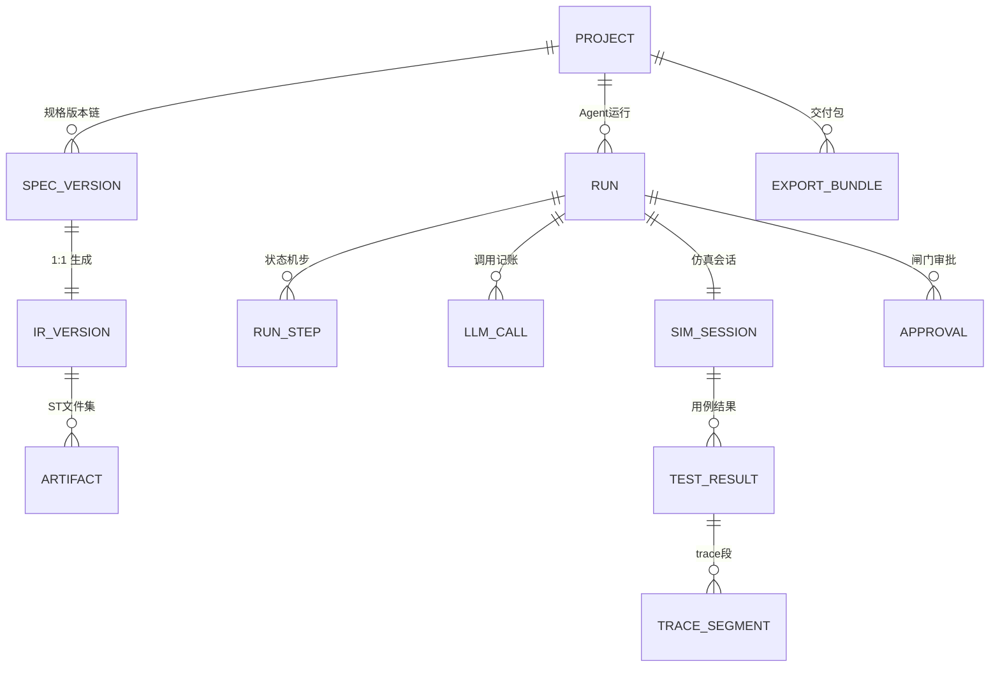

# 8. 数据架构


### 8.1 ER 概览



### 8.2 核心 DDL（PostgreSQL 16；CLI 本地无服务模式才允许 SQLite 同构降级，Web/服务端一律 PG）

```sql
CREATE TABLE project (
  id           uuid PRIMARY KEY DEFAULT gen_random_uuid(),
  code         text UNIQUE NOT NULL,          -- demo-d1
  name         text NOT NULL,
  created_at   timestamptz NOT NULL DEFAULT now()
);

CREATE TABLE spec_version (
  id           uuid PRIMARY KEY DEFAULT gen_random_uuid(),
  project_id   uuid NOT NULL REFERENCES project(id),
  seq          int  NOT NULL,                 -- 项目内递增
  yaml         text NOT NULL,                 -- Spec 全文(小,直接存)
  yaml_sha256  text NOT NULL,
  author       text NOT NULL,                 -- human / agent:debugger
  approved_by  text,                          -- 闸门通过后回填
  created_at   timestamptz NOT NULL DEFAULT now(),
  UNIQUE (project_id, seq)
);

CREATE TABLE run (                            -- 一次 Agent 闭环 = 一行
  id           uuid PRIMARY KEY DEFAULT gen_random_uuid(),
  project_id   uuid NOT NULL REFERENCES project(id),
  spec_version_id uuid NOT NULL REFERENCES spec_version(id),
  kind         text NOT NULL,                 -- generate / debug / regression
  state        text NOT NULL,                 -- 状态机当前节点
  round        int  NOT NULL DEFAULT 0,       -- Debug 轮次
  finished_at  timestamptz,
  outcome      text                           -- exported / escalated / aborted
);

CREATE TABLE run_step (
  id           bigserial PRIMARY KEY,
  run_id       uuid NOT NULL REFERENCES run(id),
  node         text NOT NULL,                 -- Clarify/StaticCheck/Simulate...
  detail       jsonb NOT NULL,                -- 各节点产物引用与摘要
  created_at   timestamptz NOT NULL DEFAULT now()
);

CREATE TABLE llm_call (
  id           bigserial PRIMARY KEY,
  run_id       uuid NOT NULL REFERENCES run(id),
  role         text NOT NULL,                 -- clarifier/debugger/...
  prompt_sha   text NOT NULL, prompt_tokens int, completion_tokens int,
  cost_micro   bigint,                        -- 微元/微美分记账
  model        text NOT NULL, latency_ms int,
  created_at   timestamptz NOT NULL DEFAULT now()
);

CREATE TABLE sim_session (
  id           uuid PRIMARY KEY DEFAULT gen_random_uuid(),
  run_id       uuid NOT NULL REFERENCES run(id),
  seed         bigint NOT NULL,               -- 确定性复现的关键字段
  scans        int,  speed_x numeric,
  trace_uri    text                           -- 对象存储中的全量 trace
);

CREATE TABLE test_result (
  id           bigserial PRIMARY KEY,
  sim_session_id uuid NOT NULL REFERENCES sim_session(id),
  case_id      text NOT NULL,
  passed       boolean NOT NULL,
  fail_reason  jsonb,                         -- 断言+TraceSummary 摘要
  coverage     jsonb NOT NULL                 -- 五维覆盖率
);

CREATE TABLE approval (
  id           bigserial PRIMARY KEY,
  run_id       uuid NOT NULL REFERENCES run(id),
  gate         text NOT NULL,                 -- Gate_Spec / Gate_Result
  decision     text NOT NULL,                 -- approved / rejected / aborted
  by_user      text NOT NULL, note text,
  created_at   timestamptz NOT NULL DEFAULT now()
);
```

trace 全量数据（每扫描每信号）放对象存储（RustFS，S3 兼容 API，boto3 客户端访问；Parquet，列：scan_no, var, value, stmt_hits），DB 只存摘要——沿用 13 号 7.4 时序数据策略口径：**库里不放大 blob**。

### 8.3 存储与缓存分层（P0 即启用）

| 层 | 技术 | 用途 | 关键约束 |
|---|---|---|---|
| 关系+向量 | PostgreSQL 16（+pgvector） | 工程库/版本链/run/审批/kb 向量 | 唯一事实来源；备份 pg_dump + WAL |
| 对象存储 | RustFS（S3 兼容） | trace Parquet、证据包 PDF、导出产物、知识库原始文档 | 桶：`trace/`（90 天转冷）、`evidence/`（永久）、`kb-source/`、`exports/`；客户端 boto3，端点可配（切 MinIO/云 S3 零代码改动） |
| 缓存&队列 | Redis 7 | SSE 事件发布（Pub/Sub）、Agent 任务队列（Arq）、闸门通知、并发行锁的快速路径、评测调度 | Redis 数据**可丢**——全部状态的事实来源在 PG，Redis 只做加速与消息管道；持久化 AOF 可选 |
