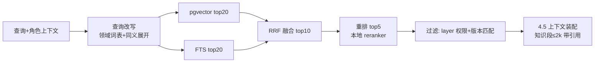
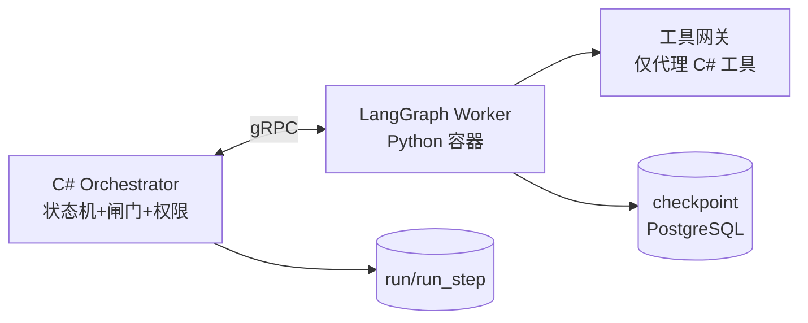

# 19. RAG 知识库与 Agent 框架生产化（v1.2）


### 19.1 知识库三层语料与摄取管线

A6 的"三层"落到工程口径：

| 层 | 语料 | 来源 | 更新方式 | 切片策略 |
|---|---|---|---|---|
| K1 规范库 | IEC 61131-3 要点自编摘要、本产品语义口径（15.1）、编码规范 | 官方标准**不入库分发**（版权），入库的是自编对照笔记 + 本产品语义表 | 随版本发布，只读 | 按语义点一节一片，`docId` 固定（语义表变更 → 哈希变更 → 缓存失效） |
| K2 厂商库 | CODESYS/三菱/西门子公开手册章节、方言差异表 | 用户自备 PDF 导入（工具不分发手册） | 增量摄取 | 按 PDF 二级标题切片 300~800 字；表格转 markdown 保结构 |
| K3 项目库 | 已批准工程的 Spec/IR/最终 ST/失败案例归因（脱敏后） | Gate_Result 通过时自动入库 | 追加 | Spec 整片 + 归因报告整片；**只入"人批准过"的版本** |

**摄取管线**（LlamaIndex 仅用于此段，检索走自有栈）：

```
导入 → 解析(PDF/MD/CSV) → 清洗(去页眉页脚/表格结构化) → 切片
     → 元数据 {layer, vendor, docId, section, version, contentHash}
     → embedding(本地 bge-m3, 1024维) → pgvector
     → FTS 索引(tsvector) 同步构建
```

每片必须带 `contentHash`：文档重导时旧片失效（软删），引用回链指向新版本——**回答里的引用必须可点开原文**，这是审计要求不是体验优化。

### 19.2 检索与生成（混合检索 + 强制引用）



**强制引用规则**（写进系统 Prompt 与输出 Schema）：凡陈述厂商行为/标准语义的句子必须带 `[docId#section]`；引用不存在的 docId → 结构校验失败重试；P2 验收"引用率 100%"（18.3）即此口径。检索无命中时明确答"知识库无依据"，**禁止用参数知识补厂商事实**——这是与通用聊天机器人的本质区别。

### 19.3 kb 相关表（补 8.2 DDL）

```sql
CREATE TABLE kb_doc (
  id          uuid PRIMARY KEY DEFAULT gen_random_uuid(),
  layer       text NOT NULL,               -- k1/k2/k3
  vendor      text,                        -- k2: codesys/mitsubishi/siemens
  title       text NOT NULL,
  source_uri  text,                        -- k3 指向 run/工程
  version     int  NOT NULL DEFAULT 1,
  created_at  timestamptz NOT NULL DEFAULT now()
);

CREATE TABLE kb_chunk (
  id          bigserial PRIMARY KEY,
  doc_id      uuid NOT NULL REFERENCES kb_doc(id),
  section     text NOT NULL,               -- 引用回链锚点
  content     text NOT NULL,
  content_hash text NOT NULL,
  embedding   vector(1024) NOT NULL,
  fts         tsvector NOT NULL,
  active      boolean NOT NULL DEFAULT true,  -- 重导后旧片置 false
  created_at  timestamptz NOT NULL DEFAULT now()
);
CREATE INDEX kb_chunk_vec ON kb_chunk USING hnsw (embedding vector_cosine_ops);
CREATE INDEX kb_chunk_fts ON kb_chunk USING gin (fts);
CREATE INDEX kb_chunk_doc ON kb_chunk (doc_id) WHERE active;
```

召回评测：20 个固定查询集（如"TON 与 TP 区别""FX5U 八进制地址""气缸超时归因"）跑 recall@5 ≥ 0.8 进 CI（每日），退化即冻结切片策略变更。embedding 模型版本记入 kb_chunk 元数据——**换模型必须全量重嵌**，杜绝新旧向量混检。

### 19.4 Agent 框架：LangGraph 集成（P1，A9 双轨）

**为什么 P0 不上**：4.2 状态机六节点、24 个工具、轮次熔断，自研 2~3 天且行为完全可控；LangGraph 引入 Python 运行时/依赖/版本面，P0 的价值在闭环不在框架。**为什么 P1 要上**：Debug 归因图会膨胀（4.4 规则 8 条 → 归因子图 + 反事实回放节点 + 人机交互中断点），LangGraph 的 checkpoint 持久化、`interrupt` 人闸、时间旅行回放与 4.2 语义同构，自研到这个复杂度成本反超。

**集成架构**（进程边界与 2.2 一致）：



| 设计点 | 口径 |
|---|---|
| 节点映射 | 4.2 六节点 = LangGraph 图六节点；Debug 归因 4.4 = 独立子图；G1~G5 闸门仍是 **C# 侧硬编码**，LangGraph 只能"请求进入下一节点"，闸门永不交给框架 |
| checkpoint | LangGraph checkpointer 落 PostgreSQL（独立 schema `lg_`），与 run_step 双写对账；崩溃恢复以 C# run 状态为准 |
| 中断 | Gate_Spec/Gate_Result 用 LangGraph `interrupt` 实现，恢复由 C# 闸门决定写入后 resume |
| 权限 | Python Worker 无 DB 直连凭据、无文件系统写、无网络出口（仅 gRPC 回 C# 工具网关）——**框架是员工，不是老板** |
| 等价回归 | 切换前跑：评测集 20 题在两实现各跑 3 次，节点序列与产物哈希全等才允许切换；配置 `agent.engine: builtin\|langgraph` 可随时回退 |
| 可观测 | LangGraph 每节点进出事件发回 C# 记 run_step；图结构导出 mermaid 附证据包 |

**LlamaIndex 边界**（19.1 已述）：只用于摄取 pipeline，不采用其索引/检索闭包——检索、存储、引用回链全部走自有 pgvector 栈，避免双框架维护。

**Semantic Kernel 落选理由**：全 .NET 可免 Python 运行时，但 2026 时点其图编排/checkpoint 生态弱于 LangGraph，且 Python Worker 与 vLLM 侧同栈，运维增量可接受。此决策在 P1 期末重新评审（LangGraph API 变化快，锁定当时 LTS 版本并记录在 kb_doc）。

### 19.5 新增风险（并入 12 章）

| 风险 | 对策 |
|---|---|
| LangGraph 版本演进快，P1 引入即被 Breaking Change 打击 | 锁版本 + 等价回归集 + `agent.engine` 回退开关 |
| RAG 语料版权（厂商手册随产品分发） | 工具只提供导入能力，手册由用户自备；K1 不入标准原文 |
| 双写（run_step 与 lg checkpoint）漂移 | 对账任务每日跑，漂移即告警并以 C# 为准修 checkpoint |

---
