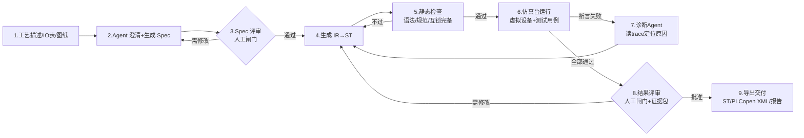
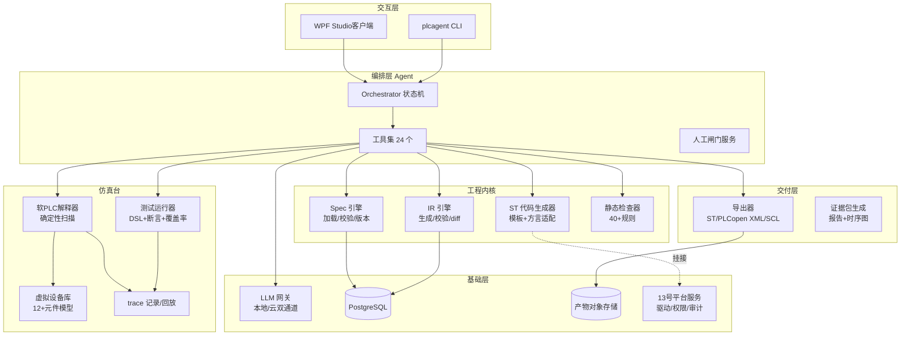
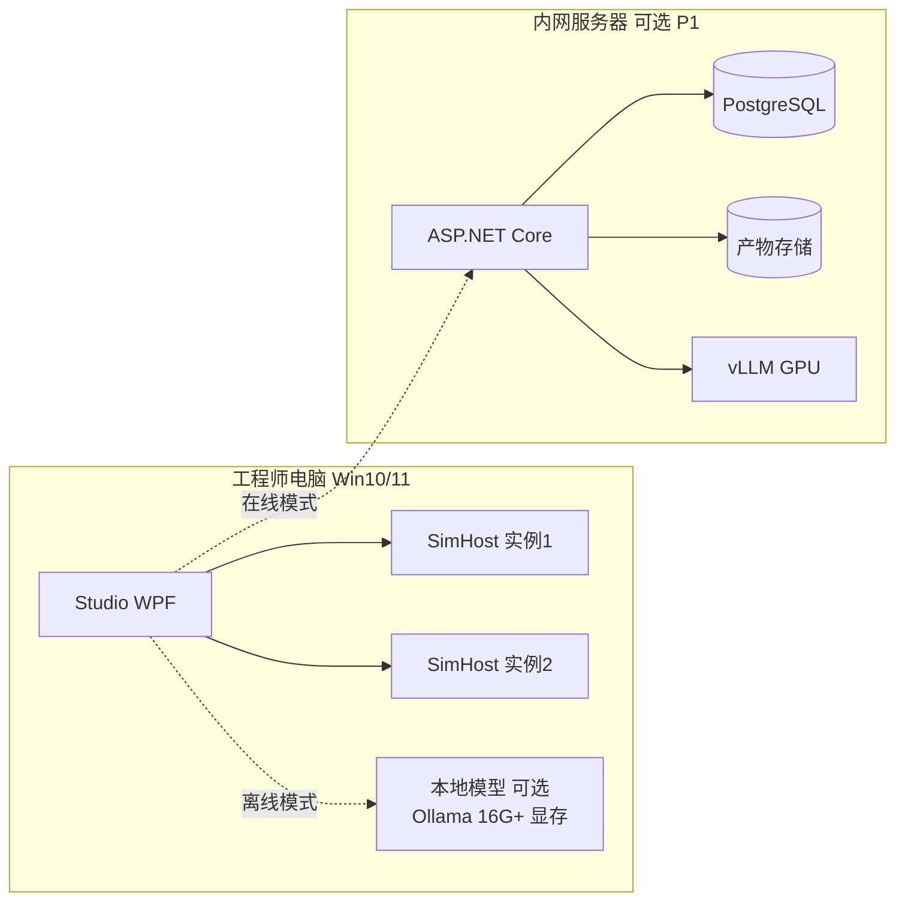
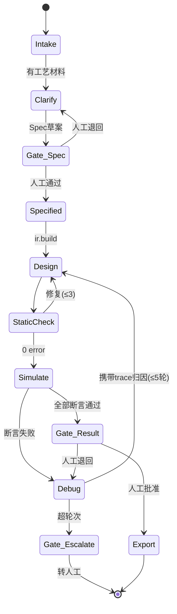
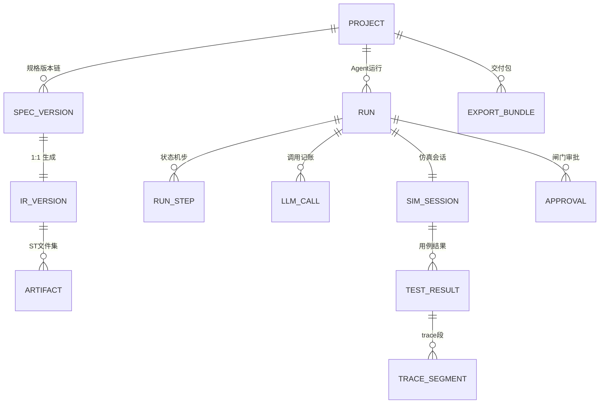
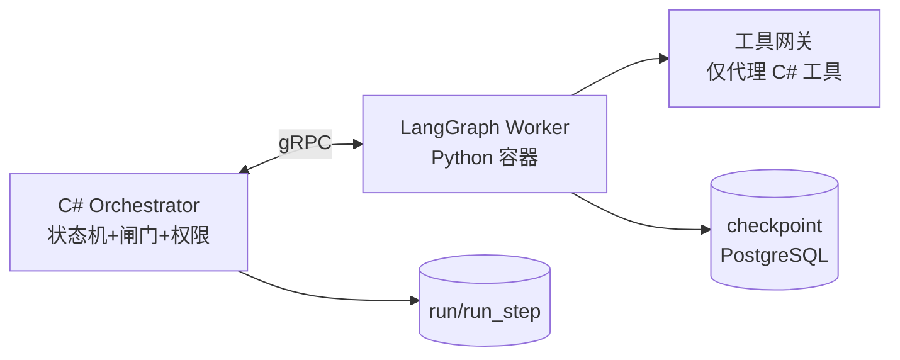

# 15 灵枢 NeuroAxis · 通用 PLC + AI 自动化编程 Agent · 软件设计文档（含模拟设备闭环）

> 返回 [总览与学习路线](00_总览与学习路线.md) ｜ 相关：[13 插件化工业软件平台](13_插件化工业软件平台_技术架构与二次开发方案.md)・[02 下位机通信实战](02_下位机通信实战.md)・[05 电工与PLC知识图谱](05_电工与PLC知识图谱.md)・[14 工业 AI 实战](14_工业AI应用实战学习手册.md)

| 项 | 内容 |
|---|---|
| 文档类型 | 软件设计文档（SDD，可直接开工的水平） |
| 版本 | v1.3（2026-11-08 落地审查后） |
| 技术栈 | .NET 8（ASP.NET Core + WPF）+ PostgreSQL 16 + 自研 ST 子集解释器 + matIEC 兼容导出 + 本地/云 LLM 双通道 |
| 适用读者 | 想做这个产品的人（含一人公司/小团队）；PLC 工程师；AI 应用工程师；投资/评审人 |
| 覆盖范围 | 产品定义、总体架构、工程模型（Spec→IR→ST）、Agent 设计、仿真验证体系、厂商适配、数据与接口、安全合规、里程碑与验收 |
| 明确不做 | 替代安全 PLC（SIL/PL 等级）、替代 EPLAN/组态软件、机器视觉算法本体、机器人离线编程 |
| 配套 | 样例工程 D1（输送线分拣）随文档完整给出，可直接作为 P0 验收脚本 |

**修订记录**

| 版本 | 日期 | 说明 |
|---|---|---|
| v1.0 | 2026-11-06 | 初稿。对齐手册既有口径：13 号平台三层模型、02 号驱动契约、09 号加药闭环。核心取舍三条：① LLM 不直接写 ST，产出受控 IR；② 仿真台是确定性"测试台"，不是演示动画；③ 真实 PLC 落地分 A/B/C 三档，不吹全自动 |
| v1.1 | 2026-11-06 | **生产级补全**（三轮审查后）：新增 13 静态检查规则全集（40 条，修复"见 6.8"悬空引用）；14 验证体系补全（五道闸门定义、测试分层、CI、评测集 20 题）；15 互操作规范（ST 精确语义表、trace Parquet schema、方言地址映射、matIEC 调用协议、PLCopen XML 元素映射）；16 运维生产化（容量模型、配置清单、错误码、故障恢复、并发资源、备份升级、发布兼容）；17 安全生产化（威胁模型、密钥管理、脱敏）；18 HMI 生成与 CLI 规格、P1/P2 验收（修复"见 6.9"悬空引用） |
| v1.2 | 2026-11-06 | **RAG 与 Agent 框架生产化**：新增 19 章——知识库三层语料与摄取管线（pgvector + BM25 混合检索 + 重排 + 强制引用）、kb 表 DDL、检索评测（recall@5）；Agent 框架选型表（自研 C# 状态机 / LangGraph / Semantic Kernel / LlamaIndex）与双轨决策（A9）；LangGraph Worker 集成架构（节点映射、checkpoint 落库、闸门语义对齐、等价回归与回退开关）；更新 2.3 选型表与 12 章风险 |
| v1.3 | 2026-11-08 | **落地审查修复**：① 修复三处悬空/失效引用——铁律 3「见 11.2」→「见 10.2」（真机写入四阶段实际在 10 章）、A5「见 7.5」/A8「见 7.6」→「见 7 章」（第 7 章无小节，A/B/C 档与许可证边界均在该章表内）；② 头表技术栈删除 LDmicro（全文从未使用，且其为 GPL，与 A8 许可证红线冲突，属「写了就可能在交付时被法务问」的死引用）；③ 16.1 trace 容量估算的扫描周期 20ms 与 Spec/16.2 配置的 10ms 统一；④ 5.4 补「D1 用例时序与 SortTimeOut 必须与 plant/params.yaml 对齐」的联调前提；⑤ 新增 20 章「对外交付边界」：商业交付时沿用 13 号 12.10~12.13 与 13.2.2 的签名/SBOM/SLA/报价口径，避免本产品独立交付时重演 C4~C7 缺失 |

---

## 0. 这份文档解决什么问题

**一句话定位：一个"从工艺描述到可运行 PLC 程序"的 AI 工程 Agent——它读需求、写程序、在虚拟设备上把程序跑通、自己找出错在哪并修好，最后交出人和测试证据，人才把程序下到真机。**

### 0.1 为什么现在做（三个现实）

1. **PLC 编程是瓶颈而非壁垒**：中小集成商一台设备 1~2 周编程调试，其中 60% 时间在做"标准件"——启停互锁、气缸时序、报警、手自动切换。这部分有明确的模式，可被生成。
2. **虚拟调试已是行业惯例**：西门子 PLCSIM、CODESYS Control Win、倍福 TC/Target 都有免费或低成本仿真运行时，"先仿真跑通再碰硬件"不需要说服客户。
3. **LLM 生成工业代码的最大障碍不是"写不出"，而是"不敢用"**：梯形图/ST 写错会撞坏设备。所以产品的核心竞争力不是生成能力，而是**验证能力**——仿真台 + 静态检查 + 证据链。这决定了架构：先建测试台，再接 LLM。

### 0.2 用户与两个付费场景

| 用户 | 痛点 | 愿意付钱的原因 |
|---|---|---|
| 小型自动化集成商（1~10 人） | 项目排队，编程人手不够 | 标准逻辑生成 + 仿真预调试，把 2 周现场调试压到 1 周 |
| 设备制造商（OEM） | 每台设备按配置出程序，改来改去 | 规格驱动生成：选配变化只改 Spec，程序重生成，测试回归自动跑 |
| 工厂电气工程师（自维护） | 看不懂老程序、不敢改 | 程序→Spec 反向解析 + 仿真验证后再下载 |

### 0.3 产品形态（一个内核，三种交付）

| 形态 | 载体 | 用途 |
|---|---|---|
| Studio 桌面端 | WPF（复用 13 号平台客户端骨架） | 工程师日常：写 Spec、看生成、盯仿真、审批下载 |
| 无头 CLI | `plcagent` dotnet tool | CI/回归：`plcagent verify --project p1 --baseline golden` |
| 服务端（可选） | ASP.NET Core + PostgreSQL | 团队共享工程库、审批留痕、知识库集中管理 |

**P0 只做 Studio + CLI，服务端 P1 再上**——一个人先跑通闭环，别一上来做多人协作。

### 0.4 与 13 号平台的关系（不重复造轮子）

本产品定位为 13 号平台的一个**能力插件**（`kind: Copilot`），复用其：设备驱动插件（02 号驱动契约）、WPF 客户端框架、RBAC/审计、日志体系。本产品自己新增的内核只有四块：

```
[Spec/IR 引擎] [ST 生成与检查] [仿真台(软PLC+虚拟设备)] [Agent 编排]
```

所以本文档只详设这四块 + 它们对 13 号契约的挂接点；登录、权限码、审计哈希链等直接引用 13 号 9 章的结论，不重写。

---

## 1. 产品定义与核心闭环

### 1.1 核心闭环（产品的灵魂，一切设计围绕它）



**三条铁律**（写进所有 Prompt 和代码注释的第一行）：

1. **LLM 永远不直接产出交付物**。它产出结构化 IR（JSON），IR 经确定性代码生成器变成 ST。人看到并审批的是 Spec 和 Diff，不是聊天记录。
2. **仿真台是测试台，不是演示**。每个生成结果必须过"五道闸门"（定义见 14.1），闸门全自动化、不可跳过、结果不可被 Agent 修改。
3. **真机写入永远人工闸门**。Agent 的权限边界是"仿真环境内为所欲为，仿真环境外一字节都写不进去"（四阶段推进见 10.2）。

### 1.2 范围定义

**做（P0/P1）**：

| # | 能力 | 期 |
|---|---|---|
| F1 | Spec 工程：YAML 定义 IO 表、设备、状态机、互锁、报警、配方 | P0 |
| F2 | IR→ST 确定性代码生成（含手自动、急停、互锁标准模板） | P0 |
| F3 | ST 子集静态检查：语法、类型、命名、双重赋值、扫描超时预估 | P0 |
| F4 | 仿真台：确定性软 PLC（10ms 扫描）+ 虚拟设备库（≥12 种元件） | P0 |
| F5 | 测试 DSL + 断言 + 覆盖率 + trace 回放 | P0 |
| F6 | Agent 闭环：Spec 生成→代码→仿真→诊断→修复（≤5 轮自动收敛） | P0 |
| F7 | 虚拟 HMI：用 Spec 自动生成操作画面（启动/停止/手自动/报警列表） | P1 |
| F8 | 厂商导出：ST 源码 + PLCopen XML（CODESYS/TwinCAT 可导入） | P1 |
| F9 | 真机对接：Modbus TCP 读写验证 + S7（PUT/GET 只读影子模式） | P1 |
| F10 | 反向解析：导入 ST→推测 IR→生成 Spec 草稿（看懂老程序） | P2 |
| F11 | 知识库 RAG：厂商手册/标准/历史项目检索，带引用回链 | P2 |
| F12 | 多品牌方言：SCL（西门子）/三菱 ST/汇川 输出适配 | P2 |

**明确不做**（每一项都是范围失控的源头）：

1. 不做安全功能生成——急停、安全门、光幕必须走安全 PLC/安全继电器，本产品生成的互锁只是"生产可用性控制"（沿用 13 号 1.3 第 7 条口径，合同里不得写"保证安全"）。
2. 不做梯形图/LD 图形化生成与渲染（P2 只读渲染评估）——图形布局是独立的大工程，ST + PLCopen XML 已可交付。
3. 不做实时性能承诺——生成的程序运行在目标 PLC 上，扫描周期实测由仿真台给出预估值（±20%），真机以厂商工具实测为准。
4. 不做视觉/机器人/运动控制卡的程序生成（运动卡见 03 号、视觉见 04 号，各有自己的工具链）。
5. 不做设备选型与电气设计（EPLAN 的活）。

### 1.3 量化验收指标（P0 结束时拿这张表打分）

| 指标 | 目标值 | 测量方法 |
|---|---|---|
| D1 样例从空工程到仿真全绿 | ≤ 30 min（含人工评审等待） | 计时脚本 |
| Spec→ST 首次生成编译通过率 | ≥ 90%（评测集 20 题） | 评测脚本统计 |
| 仿真断言全过率（≤5 轮修复内） | ≥ 95% | 同上 |
| 修复轮次中位数 | ≤ 2 | 同上 |
| 仿真速度 | ≥ 20× 实时（D1 规模 32 IO） | 虚拟时钟 vs 墙钟 |
| 扫描确定性 | 同输入 1000 次运行 trace 逐字节一致 | 哈希对比 |
| 互锁完备性检查 | 人为删除一条互锁后，静态检查必须报错 | 故障注入测试 |
| 单项目 Agent 成本 | ≤ ¥5（国产模型）或 ≤ $1（云模型） | token 计量 |
| 端到端延迟（不含人工） | ≤ 10 min | 计时 |

> 这张表 P0 期间每周五跑一次全量，数字退化就停下修，不往前走。

### 1.4 关键架构决策（ADR）

| # | 决策 | 理由 | 放弃的方案 | 代价 |
|---|---|---|---|---|
| A1 | LLM 产出 IR（JSON），IR→ST 由确定性模板生成 | 消除语法幻觉；IR 可校验、可 diff、可回归 | LLM 直写 ST | 表达力受限，遇超出 IR 的逻辑走"表达式块"逃生舱（仍受静态检查约束） |
| A2 | 自研 ST 子集解释器做仿真执行 | 确定性可控、可插桩（覆盖率/trace）、零外部依赖 | 直接用 OpenPLC/matIEC 编译执行 | 需实现 ~30 个标准 FB；子集外指令不支持 |
| A3 | ST 子集 + 逃生舱架构 | 解释器只需覆盖子集；子集覆盖 80% 常规逻辑 | 全量 IEC 61131-3 | 少数复杂算法（如模糊控制）P2 再议 |
| A4 | 仿真与真机同一份 Spec 驱动 | IO 映射一处定义，仿真与导出共用 | 仿真单独配 | Spec 设计要一次到位 |
| A5 | 厂商落地分 A/B/C 三档（见 7 章） | 诚实面对厂商工具链封闭现实 | 承诺全自动下载 | 高档目标需要厂商许可/在场工具 |
| A6 | 知识库分三层：规范库/厂商库/项目库，检索必带引用 | 防幻觉、可审计 | 无引用自由生成 | 维护成本 |
| A7 | P0 单机、P1 才上服务端 | 先验证闭环价值 | 一开始微服务 | 后续重构成本可控（模块边界已按服务切） |
| A8 | 许可证红线：不静态链接任何 GPL 运行时 | 商用前提 | 嵌 OpenPLC | matIEC 以外部进程调用（LGPL 边界，见 7 章末） |
| A9 | Agent 编排双轨：P0 自研 C# 状态机；P1 引入 LangGraph（Python Worker）承载 Debug 归因图，语义对齐后可切换 | 自研闭环快且可控；LangGraph 的 checkpoint/中断恢复/图可视化是 P1 多角色协作的刚需，自研到 P1 会重复造轮子且难对齐 | 全自研到底 / 一开始就上 LangGraph | 双轨维护成本 → 用"等价回归集"约束切换（19.4），配置开关可回退 |

---

## 2. 总体架构

### 2.1 分层架构



### 2.2 运行时组件与进程模型

| 组件 | 进程 | 职责 | 关键约束 |
|---|---|---|---|
| Studio / CLI | 前台 | 交互、发起任务、展示 | 不直接碰 DB 以外的任何端口 |
| Orchestrator | 同进程后台 Host | Agent 状态机、闸门、重试 | 一次任务一个 RunId，全链路打点 |
| SimHost | 独立进程（可多实例） | 软 PLC + 虚拟设备 + 测试 | 崩溃不影响 Studio；确定性执行 |
| LangGraph Worker（P1） | Python 容器 | Debug 归因子图、checkpoint、interrupt | 无 DB 凭据/无文件写/无网络出口，仅 gRPC 回工具网关（19.4） |
| LlmGateway | 同进程 | 请求编排、限流、成本记账、脱敏 | 本地/云可切；云通道默认脱敏 |
| Exporter | 按需子进程 | matIEC 调用（LGPL 边界） | 独立进程、独立目录、不留驻 |

**进程隔离的理由**：软 PLC 跑的是机器生成的代码（哪怕在解释器里），SimHost 崩溃/卡死必须能被外部强杀重启而不丢 Studio 状态；这也是后续上服务端时的天然拆分线（A7）。

### 2.3 技术选型

| 能力 | 选型 | 版本 | 理由 | 替代 |
|---|---|---|---|---|
| 运行时 | .NET 8 | LTS | 与手册全系列一致 | — |
| 客户端 | WPF + CommunityToolkit.Mvvm | 8 | 复用 13 号骨架 | Avalonia（要跨 Linux 时） |
| 服务端 | ASP.NET Core Minimal API + SignalR | 8 | 实时推送仿真进度 | — |
| 主库 | PostgreSQL 16 | 16 | JSONB 存 Spec/IR，分区存 trace 摘要 | SQLite（单机 P0 降级可用） |
| ST 解析 | 自研递归下降（Antlr4 备选） | — | 需要精确错误位置与插桩钩子 | Antlr4（语法复杂后切换） |
| matIEC | 外部进程调用 iec2c | 0.5+ | 语法二次校验 + 参考编译 | 不集成（P0 可不装） |
| PLCopen XML | 自研序列化 | TC6 v2.0 | CODESYS/TwinCAT 互通 | — |
| Modbus | NModbus（MIT） | 3.x | 02 号已用，驱动契约兼容 | — |
| S7 | S7NetPlus（MIT） | 0.20 | 只读影子模式 | Snap7（LGPL，避免） |
| LLM | OpenAI 兼容协议统一网关 | — | 本地 vLLM/Ollama 与云同构 | — |
| 本地模型 | Qwen 系 32B 级 / DeepSeek 蒸馏，vLLM 部署 | — | 内网离线；工业现场数据不出厂 | 云 API |
| RAG 检索 | pgvector（PG 16 内）+ PostgreSQL FTS（BM25 近似）混合，RRF 融合；bge-m3 类本地 embedding | — | 不新增独立向量库，运维面最小；混合检索对术语型查询（"TON 语义"）强于纯向量 | Milvus/Qdrant（语料 >百万片再上） |
| 重排 | 本地 bge-reranker 或 LLM listwise（P2） | — | 检索质量主要瓶颈在切片与查询改写，不在重排模型 | — |
| Agent 框架（P1） | LangGraph（Python 3.12 Worker）承载 Debug 归因子图 | 0.2+ | checkpoint 持久化、中断恢复、时间旅行调试与 4.2 状态机语义同构 | Semantic Kernel（全 .NET）、自研扩展 |
| 索引框架 | LlamaIndex 仅作摄取侧 pipeline（文档解析/切片/元数据抽取） | — | 解析能力现成；检索/存储仍走自有 pgvector，不绑其索引闭包 | 自研解析（PDF/表格复杂时成本高） |
| 图表 | ScottPlot | 5 | trace 波形高性能渲染 | LiveCharts2 |
| 报告 | QuestPDF | 2024.x | 证据包 PDF | — |

### 2.4 部署拓扑（P0/P1）



P0 最低配：一台 i5/16G 无 GPU 电脑 + 云 API（或小参数本地模型）即可跑通 D1。

---

## 3. 工程模型：Spec → IR → ST（三段式）

### 3.1 为什么是三段而不是 LLM 直写

| 失败模式 | 直写 ST 的下场 | 三段式的解法 |
|---|---|---|
| 语法幻觉（写了不存在的指令） | 编译失败，反复来回 | IR 由 JSON Schema 卡住，非法字段根本进不了生成器 |
| 规范漂移（命名、注释、结构各项目不一样） | 不可维护 | 模板统一产出，规范是代码不是提示词 |
| 互锁遗漏 | 撞机事故 | 互锁在 Spec 里显式声明，静态检查核对完备性 |
| 不可回归 | 改一处坏三处 | IR diff 即程序 diff，测试集自动回归 |
| 审计困难 | 只有一堆聊天记录 | Spec/IR/ST 三层版本链，每次变更可追溯 |

**逃生舱**：Spec 表达不了的计算（如特殊标定公式），用 `compute` 块写受限表达式（支持算术/比较/逻辑/标准函数，禁指针禁循环），同样过静态检查。IR 表达不了的控制结构（极少数），P2 开"专家模式"允许 LLM 直写 ST 片段，但强制走同一套静态检查 + 仿真闸门 + 人工评审。

### 3.2 Spec 结构（YAML，人直接读写的唯一交付层）

```yaml
specVersion: "1.0"
project: { id: demo-d1, name: 输送线分拣D1, scanMs: 10 }

io:
  digital:
    - { name: EStop_OK,      dir: in,  addr: "%I0.0", desc: 急停回路正常(常闭) }
    - { name: Start_PB,      dir: in,  addr: "%I0.1", desc: 启动按钮 }
    - { name: Stop_PB,       dir: in,  addr: "%I0.2", desc: 停止按钮 }
    - { name: PE_Entry,      dir: in,  addr: "%I0.3", desc: 入口光电 }
    - { name: PE_SortPos,    dir: in,  addr: "%I0.4", desc: 分拣位光电 }
    - { name: Cyl1_Extended, dir: in,  addr: "%I0.5", desc: 推料缸伸出到位 }
    - { name: Cyl1_Retracted,dir: in,  addr: "%I0.6", desc: 推料缸缩回到位 }
    - { name: Conv_Run,      dir: out, addr: "%Q0.0", desc: 输送带电机 }
    - { name: Cyl1_Out,      dir: out, addr: "%Q0.1", desc: 推料电磁阀 }
    - { name: HMI_Running,   dir: out, addr: "%Q0.2", desc: 运行指示 }
    - { name: HMI_Fault,     dir: out, addr: "%Q0.3", desc: 故障指示 }

modes: [Auto, Manual]          # 手/自动
params:                        # 配方参数(可在HMI改)
  - { name: SortTimeOut, type: TIME, value: 2s, desc: 分拣动作超时 }

machines:
  - name: ConvLine             # 主状态机
    initial: Idle
    states:
      - { name: Idle,    entry: [Conv_Run:=0, Cyl1_Out:=0] }
      - { name: Running, entry: [HMI_Running:=1] }
      - { name: Sorting, entry: [Conv_Run:=0] }
      - { name: Fault,   entry: [Conv_Run:=0, Cyl1_Out:=0, HMI_Fault:=1] }
    transitions:
      - { from: Idle,    to: Running, when: "Auto AND Start_PB AND EStop_OK", prio: 1 }
      - { from: Running, to: Idle,    when: "Stop_PB OR NOT EStop_OK", prio: 1 }
      - { from: Running, to: Sorting, when: "PE_SortPos", prio: 2 }
      - { from: Sorting, to: Running, when: "Cyl1_Seq.done", prio: 1 }
      - { from: "*",     to: Fault,   when: "Cyl1_Seq.fault", prio: 0 }   # prio 0 最高

sequences:                     # 子时序(气缸往复)
  - name: Cyl1_Seq
    type: ExtendRetract        # 内置模板: 伸出→等伸出到位→缩回→等缩回到位
    bind: { out: Cyl1_Out, ext: Cyl1_Extended, ret: Cyl1_Retracted, timeout: SortTimeOut }

interlocks:                    # 互锁: 任何状态强制执行
  - { when: "NOT EStop_OK", then: [Conv_Run:=0, Cyl1_Out:=0], desc: 急停切断 }
  - { when: "mode=Manual",  then: [Conv_Run:=manual_jog],     desc: 手动点动 }

alarms:
  - { code: AL01, cond: "Cyl1_Seq.fault", text: 推料缸动作超时, level: fault }
```

**字段口径**：`io.addr` 是 IEC 地址（导出时按方言转换）；`transitions.prio` 小者优先（解决同时满足）；`from: "*"` 表示任意状态；`sequences` 只允许内置模板（P0 三种：`ExtendRetract`、`StartStopHold`、`PulseWait`），模板库随版本扩充并逐一做单元仿真——**模板是确定性的来源，宁可少而硬**。

### 3.3 IR 模型（C# 核心类型）

```csharp
// PlcAgent.Ir / Model.cs —— 与 13 号插件契约同风格，纯不可变 record
public sealed record IrProject(
    string SpecHash,                       // 溯源: 生成自哪版 Spec
    string ScanMs,
    IReadOnlyList<IrIo> Io,
    IReadOnlyList<IrMachine> Machines,
    IReadOnlyList<IrSequence> Sequences,
    IReadOnlyList<IrInterlock> Interlocks,
    IReadOnlyList<IrCompute> Compute,
    IReadOnlyList<IrAlarm> Alarms,
    IReadOnlyList<IrParam> Params);

public sealed record IrMachine(
    string Name, string InitialState,
    IReadOnlyList<IrState> States,
    IReadOnlyList<IrTransition> Transitions);

public sealed record IrTransition(
    string From, string To, IrExpr Guard, int Priority);   // Guard 是语法树,不是字符串!

public sealed record IrExpr(IrExprKind Kind, ...);          // AND/OR/NOT/CMP/VAR/LIT
```

**关键点：`Guard` 在 IR 里是语法树而非字符串**。Spec 加载时就把表达式解析成树（复用 ST 表达式解析器），这一步就消灭了"LLM 写了个奇怪表达式"的整类问题；语义校验（变量存在、类型匹配、无未定义引用）直接在树上做。

**IR 语义校验规则（P0 实现 16 条）**：

| # | 规则 | 级别 |
|---|---|---|
| V1 | 引用的 IO/参数/状态必须存在 | 错 |
| V2 | 输出点在 machines+interlocks+sequences 中有且只有一个"常态驱动者"，其余必须是互锁强制 | 错 |
| V3 | 每台设备（电机/气缸/阀）至少有一条包含其输出切断的互锁 | 错 |
| V4 | 状态机可达性：从 initial 出发所有状态可达 | 错 |
| V5 | 状态机无死锁：每个状态至少一条出边（含 "*" 边） | 错 |
| V6 | transition 同一 from 下 prio 不得重复 | 错 |
| V7 | sequence 绑定的 IO 方向正确（out→out, ext→in） | 错 |
| V8 | 表达式类型匹配（BOOL 量做逻辑运算、TIME 与 TIME 比较） | 错 |
| V9 | params 命名符合 PascalCase、io 符合 Spec 词汇表 | 警 |
| V10 | 每条 alarm 的 cond 中至少引用一个会翻转的内部信号 | 警 |
| V11 | scanMs ∈ {1,5,10,20,50} | 错 |
| V12 | 状态数 ≤ 32 / 状态机数 ≤ 8 / 互锁 ≤ 64（解释器资源上限） | 错 |
| V13 | 急停信号（EStop_OK 或等价）必须出现在至少一条互锁 | 错 |
| V14 | 输出初始值显式声明（每个 state 的 entry 覆盖其所属输出） | 警 |
| V15 | compute 块禁止循环/递归/指针/直接地址 | 错 |
| V16 | 全部 IO 已被引用（防拷贝模板留下死点） | 警 |

### 3.4 IR→ST 生成器

确定性模板生成，一个 POU 一个文件：

```
PRG_Main.st        主程序：任务调度 + 状态机 CASE + 互锁兜底
FB_Machine_<N>.st  每台状态机一个 FB（可复用、可单测）
FB_Seq_<模板>.st   时序模板库
GVL_Main.st        全局变量（IO 映射 + params）
PRG_Alarm.st       报警装配
```

生成规则示例（状态机 → ST）：

```iecst
FUNCTION_BLOCK FB_Machine_ConvLine
VAR_INPUT
    Auto        : BOOL;
    Start_PB    : BOOL;
    Stop_PB     : BOOL;
    EStop_OK    : BOOL;
    PE_SortPos  : BOOL;
    Cyl1_Seq_done  : BOOL;
    Cyl1_Seq_fault : BOOL;
END_VAR
VAR_OUTPUT
    State : INT;              // 0=Idle 1=Running 2=Sorting 3=Fault
    Conv_Run, HMI_Running, HMI_Fault : BOOL;
END_VAR
VAR
    prevState : INT := 0;
END_VAR
// ---- 状态转移: prio 升序, 先命中先走 ----
CASE State OF
  0: IF Auto AND Start_PB AND EStop_OK THEN State := 1; END_IF;
  1: IF Cyl1_Seq_fault THEN State := 3;
     ELSIF Stop_PB OR NOT EStop_OK THEN State := 0;
     ELSIF PE_SortPos THEN State := 2; END_IF;
  2: IF Cyl1_Seq_done THEN State := 1; END_IF;
  3: IF EStop_OK AND NOT Cyl1_Seq_fault THEN State := 0; END_IF;  // 故障复位条件由Spec给出
END_CASE;
// ---- entry 动作: 状态变化沿执行一次 ----
IF State <> prevState THEN
  CASE State OF
    0: Conv_Run := FALSE; Cyl1_Out := FALSE; HMI_Running := FALSE;
    1: HMI_Running := TRUE;
    2: Conv_Run := FALSE;
    3: Conv_Run := FALSE; Cyl1_Out := FALSE; HMI_Fault := TRUE;
  END_CASE;
  prevState := State;
END_IF;
END_FUNCTION_BLOCK
```

> 生成器输出保证三条：①任何输出在每个扫描周期的赋值路径可枚举（供 V2 静态核对）；②所有变量先声明后用、零隐式；③文件头带 SpecHash——**程序可反向追溯到 Spec 版本**。

### 3.5 手自动与急停的标准模板（用户最常见的三个问题，直接内置）

| 需求 | 模板行为 | Spec 表达 |
|---|---|---|
| 手/自动 | `mode` 枚举由模式开关驱动；Auto 模式下状态机生效，Manual 模式下仅 `manual_*` 互锁行生效 | `modes: [Auto, Manual]` |
| 急停 | EStop 断开 → 0 优先级 "*" 边强制进 Fault → 互锁再兜底切断全部动力输出 | V13 静态强制 |
| 故障复位 | Fault 状态的复位条件 = 各 sequence 的 fault 清除 + 复位按钮 | `faultReset` 字段 |

---

## 4. AI Agent 设计

### 4.1 角色与工具（不是聊天机器人，是流水线工人）

Agent 系统由 1 个编排器 + 6 个角色组成，每个角色只做一类事，工具权限各不相同：

| 角色 | 输入 | 输出 | 可用工具 | LLM 用途 |
|---|---|---|---|---|
| Clarifier | 工艺描述/图纸OCR/IO表 | Spec 草案 + 澄清问题列表 | io.infer, kb.search | 抽取 IO 表、设备、模式；**生成澄清问题**（缺急停/缺到位传感器必问） |
| Specifier | Spec 草案 + 人工答复 | 定稿 Spec | spec.validate, spec.diff | 合并答复、补齐互锁/报警 |
| Designer | 定稿 Spec | IR | ir.build, ir.check | 状态机拆分建议（主/子时序归属） |
| Coder | IR | ST 文件集 | gen.render, sta.check | 仅逃生舱表达式；常规路径不调 LLM |
| Debugger | 失败断言 + trace 摘要 | Spec 修改提案 | trace.summarize, sim.replay, ir.patch | **核心 LLM 场景**：从 trace 归因（是转移条件错/时序超时/互锁冲突） |
| Reporter | 全过程产物 | 证据包 | rpt.render | 摘要生成 |

**权限矩阵（硬编码在 Orchestrator，Prompt 改不了）**：只有 Specifier 能写 Spec；只有 Debugger 能发起 Spec 修改提案；Coder 没有 LLM 写文件权限；所有角色都不能跑 `sim.run`（仿真只由 Orchestrator 触发，防止 Agent 自己"看着像对了"就过）。

### 4.2 Orchestrator 状态机



**轮次预算**：Design↔StaticCheck 3 轮；Debug 5 轮；总 LLM 调用 ≤ 60 次 / RunId，超预算强制升级人工。所有轮次状态落库（见 9 章），Studio 断线重连可恢复。

### 4.3 工具契约（24 个，节选核心 8 个）

```csharp
// PlcAgent.Agent/Tools.cs —— 每个工具: 强类型入参出参 + 幂等 + 超时 + 审计
public interface IAgentTool<TIn, TOut>
{
    string Name { get; }                       // "spec.validate"
    ToolPerm Perm { get; }                     // Read/WriteSpec/RunSim/Export
    TimeSpan Timeout { get; }
    Task<TOut> ExecuteAsync(TIn input, ToolContext ctx, CancellationToken ct);
}

public sealed record TraceSummary(           // Debugger 的眼睛, 不是原始trace
    string FailingAssertion,
    int FailScan,                            // 失败发生在第几个扫描
    IReadOnlyList<SignalEvent> WindowEvents, // 失败前 N=200 扫描内的信号翻转
    IReadOnlyList<string> ActiveStates,      // 各状态机当前状态
    IReadOnlyList<string> SuspicionHints);   // 规则引擎给的线索(见4.4)
```

| 工具 | 作用 | 关键点 |
|---|---|---|
| `io.infer` | 从文本/表格抽 IO 点 | 输出必须带 confidence，<0.8 进澄清清单 |
| `spec.validate` | Spec 校验（3.2 规则 + JSON Schema） | 错误带 YAML 行号 |
| `ir.check` | 3.3 的 16 条语义规则 | V2/V3/V13 是安全规则，不可跳过 |
| `gen.render` | IR→ST | 纯函数，同 IR 恒同输出 |
| `sta.check` | ST 静态检查（40 条规则，全集见 13 章） | 见 13 章 |
| `sim.run` | 跑测试集 | 只由 Orchestrator 调 |
| `trace.summarize` | 全量 trace → 摘要 | 控 token：窗口 200 扫描 + 只留变化信号 |
| `ir.patch` | 生成 Spec 修改提案（diff 形式） | 人工可见可拒；不直接改 |

### 4.4 Debugger 归因规则（先规则后 LLM，省 token 且可解释）

失败断言先过 8 条确定性归因规则，命中则直接给结论（LLM 只写人话解释）；不命中才上 LLM：

| # | 现象 | 归因 |
|---|---|---|
| D1 | 转移条件中某信号在整个窗口从未为 TRUE | 该信号驱动侧缺失/条件永假 → 查上游状态 |
| D2 | sequence 超时（fault） | 到位传感器未到 → 查 plant 参数（如气缸行程时间 > timeout） |
| D3 | 互锁把输出压住了 | 预期内：改 Spec 时序，不改互锁 |
| D4 | 两状态机对同一输出冲突 | V2 漏网 → 升级为静态检查缺陷，**记产品 bug 而不是改 Spec** |
| D5 | 断言时间窗边缘失败 | 时序裕量不足 → 建议调 params |
| D6 | plant 输入与 IO 映射不符 | 映射错位 → Spec addr 错 |
| D7 | 首扫描即错 | 初始化缺失 → 查 entry 动作覆盖 |
| D8 | 间歇性失败（重跑消失） | 确定性被破坏 → **记产品 bug**（仿真台绝不允许非确定性） |

### 4.5 LLM 上下文装配（token 预算硬上限）

| 段 | 内容 | 上限 |
|---|---|---|
| 系统 | 铁律 + 角色职责 + 输出 JSON Schema | 1.5k |
| 规范 | 命名/编码规范摘要 + 3.3 校验规则 | 1k |
| 知识 | kb.search 命中片段（带引用） | 2k |
| 项目 | 当前 Spec（或 diff）+ 相关 IR 节选 | 3k |
| 任务 | 具体指令 + 澄清答复 | 1k |
| 反馈 | TraceSummary（仅 Debugger） | 2k |

超限策略：先砍知识段、再砍项目段到 diff、**永不砍系统段**。温度 0.2；结构化输出强制 JSON Schema 校验，失败重试 2 次后降级规则引擎。

### 4.6 人工闸门的两级实现

| 闸门 | 界面 | 通过动作 |
|---|---|---|
| Gate_Spec | Spec 编辑器高亮 diff + 校验结果 + 澄清问题 | 「批准并继续」/「修改」/「终止」，落审批表 |
| Gate_Result | 仿真报告（断言/覆盖率/波形）+ ST diff | 同上，批准后解锁导出 |

P0 单人（自审批留痕即可）；P1 接 13 号 RBAC 双人复核（9.6 节）。

---

## 5. 仿真台（产品的护城河）

### 5.1 确定性模型（一切可重放的基础）

| 项 | 规则 |
|---|---|
| 时基 | 虚拟时钟 `simTime = scanNo × scanMs`，与墙钟解耦；实时模式 1×，加速模式尽力跑 |
| 扫描 | 读输入映像 → 执行任务（单线程，固定顺序）→ 写输出映像 → trace 记录 |
| 植物步长 | 虚拟设备固定 1ms 步长积分，每个扫描周期内步进 scanMs 次 |
| 随机 | 仅传感器噪声用随机，种子 = `hash(SpecHash, RunId, caseId)` |
| 通信 | P0 无通信延迟模拟（进程内直连映像）；P1 加可配延迟/丢包注入 |
| 快照 | 每 100 扫描可快照（全变量+植物状态），支持"断点回退到第 N 扫描重放" |

**验收 A2 硬指标**：同 Spec+同用例跑 1000 次，trace SHA256 全等。这条做不到，覆盖率、回归、Debugger 全部失效——它是第一优先级实现项。

### 5.2 软 PLC 解释器（子集语义）

支持集合（= 3.1 生成器会产出的全部 + 手写逃生舱允许的）：

| 类别 | 支持 | 明确不支持 |
|---|---|---|
| 类型 | BOOL/BYTE/INT/DINT/UINT/UDINT/REAL/TIME/STRING/ARRAY[定长] | 指针/REF、联合、OOP(METHOD/PROPERTY) |
| 语句 | 赋值/IF/CASE/FOR/WHILE/REPEAT/RETURN | GOTO |
| 标准FB | TON/TOF/TP/CTU/CTD/CTUD/R_TRIG/F_TRIG/SR/RS/PID | RTOS 相关、文件、SOE |
| 任务 | 单任务循环扫描（P1 加多任务优先级） | 事件任务、中断 |

扫描内执行语义与 IEC 61131-3 对齐的点：TON 基于虚拟时钟累计（非墙钟）；CASE 落空不报错但插桩计数（覆盖率用）；变量无显式初始化时 BOOL=FALSE/数值=0 并打 V14 警告。

解释器插桩四件套（为覆盖率与 trace 服务，这是"为什么不直接用 OpenPLC"的根因）：

```csharp
public interface IInstrumentedRunner
{
    void OnBeforeStatement(int stmtId);          // 分支/语句覆盖打点
    void OnVarWrite(string var, IrValue v);      // trace
    void OnVarRead(string var, IrValue v);
    int  CurrentScan { get; }                    // 断点/回退用
}
```

### 5.3 虚拟设备库（P0 12 种，每种 ≤200 行 + 单元测试）

| 元件 | 输入 | 输出 | 模型 | 关键参数 |
|---|---|---|---|---|
| 电机(M带减速器) | Run | running, speed, pos | 一阶速度环 τ=200ms | τ, 额定转速 |
| 输送线 | motor_on | pe_out(光电), item_at(x) | 质点匀速+队列 | 长度, 速度, 间距 |
| 气缸 | valve_out | extended, retracted | 双稳态+匀速行程 | 行程ms, 磁开位置 |
| 泵 | run | flow | 线性流量 | Qmax |
| 阀(开关) | open_cmd | opened, closed, pos | 同气缸 | 行程ms |
| 阀(调节) | opening% | flow | 快开/线性特性 | Cv, 特性 |
| 液位罐 | in_flow, out_flow | level, hi, lo, hh, ll | dv/dt=(Qi-Qo)/A | 面积A, 量程 |
| 压力/温度变送 | 物理量 | 4-20mA 数字值 | 量程线性+噪声 | 量程, 噪声σ |
| 光电/接近 | 物理遮挡 | bool | 阈值+回差 | 回差 |
| 编码器 | 轴角 | count | 正交计数 | PPR |
| 加热器 | pwm | temp | 一阶热容 | C, 散热系数 |
| 计数品 | 检测沿 | count | 事件 | — |

**元件接口**：

```csharp
public interface IPlantComponent
{
    void Bind(IoImage io, PlantParams p);   // 与 Spec io.addr 映射
    void Step(double dt);                   // dt=1ms, 读输出映像→物理演化→写输入映像
    void Inject(Fault f);                   // 故障注入: 卡死/漂移/断线/恒值
    PlantSnapshot Snapshot();
}
```

**故障注入矩阵（测试用例的常客）**：卡死在位 / 传感器恒0恒1 / 漂移+10% / 断线(质量位Bad) / 延迟响应 / 噪声增大 / 急停触发 / 扫描超时注入。

### 5.4 测试 DSL 与断言

> **用例与 plant 参数必须对齐**：`expect` 里写死的时间窗（如 `afterMs: 3500`）隐含了「气缸行程 ≈ 2s + 磁开响应」的 plant 参数假设。**用例、Spec 的 `SortTimeOut`、`plant/params.yaml` 三处必须同源校验**——Runner 启动时核对：用例中出现的最大 `afterMs + withinMs` 不得 ≥ `SortTimeOut`（否则正常循环必触发超时报警）；plant 行程时间改动后，黄金基线 trace 必须重录。这条不做，评测集会因参数漂移「无差别变红」，烧掉对确定性的一切信任。

```yaml
suite: demo-d1
cases:
  - id: normal_cycle
    desc: 正常分拣一循环
    init: { EStop_OK: true, Cyl1_Retracted: true }
    steps:
      - { set: { Start_PB: true } }
      - { expect: { Conv_Run: true, withinMs: 100 } }
      - { set: { Start_PB: false } }
      - { set: { PE_SortPos: true } }           # 或用 plant 驱动: - { drive: conveyor.push_item() }
      - { expect: { Cyl1_Out: true, withinMs: 200 } }
      - { expect: { Cyl1_Out: false, afterMs: 3500, withinMs: 500 } }  # 伸出到位后缩回
  - id: estop_mid_cycle
    desc: 分拣中急停
    steps:
      - { set: { PE_SortPos: true } }
      - { set: { EStop_OK: false } }
      - { expect: { Conv_Run: false, Cyl1_Out: false, withinMs: 50 } }  # 5个扫描内
      - { assert_never: { expr: "Conv_Run AND Cyl1_Out", whole_case: true } }
  - id: timeout_fault
    desc: 气缸超时故障
    inject: { Cyl1_Extended: stuck_0 }
    ...
asserts:                                       # 全局不变式(每个用例都查)
  - { expr: "NOT (Conv_Run AND State=3)", desc: 故障态不得运行 }
coverage_gate: { statement: 100, branch: 90, state: 100, transition: 100, io_write: 100 }
```

**断言类型**：`expect`（点值+时间窗）/ `assert_never`（不变式）/ `expect_seq`（时序次序）/ `coverage_gate`（门禁）。`drive:` 语法直接调用虚拟设备行为（推一件料），比手工拨 IO 自然。

### 5.5 覆盖率门禁

| 维度 | 来源 | P0 门禁 |
|---|---|---|
| 语句/分支 | 解释器插桩 | 100% / 90% |
| 状态/转移 | IR 状态机执行记录 | 100% / 100%（生成代码天然可全测，测不全说明用例缺） |
| IO 写覆盖 | OnVarWrite | 每个 out 点至少一次 TRUE 和一次 FALSE |
| 故障注入 | 用例标注 | V3 互锁清单每条至少一个用例触发 |

## 6. 诊断与修复闭环（最值钱的一段）

Simulate 失败 → `trace.summarize` → 4.4 规则归因 → `ir.patch` 出 Spec diff 提案 → Orchestrator 校验（V1~V16）→ 重新生成 → 回归**全量**用例（防修好 A 坏 B）。5 轮不收敛升级人工，并附前几轮归因对比（避免原地打转——连续两轮同类归因直接升级）。

## 7. 导出与厂商适配（A/B/C 三档，别吹）

| 档 | 目标 | 交付物 | 人工动作 |
|---|---|---|---|
| A 全自动 | OpenPLC Runtime / CODESYS Control Win（仿真/软PLC） | ST 源码 + matIEC 编译通过 + 下载脚本 | 一键 |
| B 半自动 | 西门子 S7-1200/1500（TIA Openness）、CODESYS IDE | SCL/ST + PLCopen XML + 变量表 CSV，Openness Worker 自动建块导入（需本机装 TIA） | 确认硬件组态、编译、下载 |
| C 仅交付 | 三菱 FX5U、汇川、欧姆龙 | ST/指令表 + IO 表 + 接线说明，工程师导入 | 全人工导入 |

三档共用同一份 IR，只是导出器不同。**硬件组态、安全组态永远人工**（这是 B 档的边界，不是缺陷）。

许可证红线（A8）：matIEC 以独立子进程调用、独立目录存放（LGPL 边界）；不静态链接 OpenPLC 运行时；S7NetPlus/NModbus 为 MIT 可放心商用。

---

## 8. 数据架构

### 8.1 ER 概览



### 8.2 核心 DDL（PostgreSQL 16，SQLite 同构降级）

```sql
CREATE TABLE project (
  id           uuid PRIMARY KEY DEFAULT gen_random_uuid(),
  code         text UNIQUE NOT NULL,          -- demo-d1
  name         text NOT NULL,
  created_at   timestamptz NOT NULL DEFAULT now()
);

CREATE TABLE spec_version (
  id           uuid PRIMARY KEY DEFAULT gen_random_uuid(),
  project_id   uuid NOT NULL REFERENCES project(id),
  seq          int  NOT NULL,                 -- 项目内递增
  yaml         text NOT NULL,                 -- Spec 全文(小,直接存)
  yaml_sha256  text NOT NULL,
  author       text NOT NULL,                 -- human / agent:debugger
  approved_by  text,                          -- 闸门通过后回填
  created_at   timestamptz NOT NULL DEFAULT now(),
  UNIQUE (project_id, seq)
);

CREATE TABLE run (                            -- 一次 Agent 闭环 = 一行
  id           uuid PRIMARY KEY DEFAULT gen_random_uuid(),
  project_id   uuid NOT NULL REFERENCES project(id),
  spec_version_id uuid NOT NULL REFERENCES spec_version(id),
  kind         text NOT NULL,                 -- generate / debug / regression
  state        text NOT NULL,                 -- 状态机当前节点
  round        int  NOT NULL DEFAULT 0,       -- Debug 轮次
  finished_at  timestamptz,
  outcome      text                           -- exported / escalated / aborted
);

CREATE TABLE run_step (
  id           bigserial PRIMARY KEY,
  run_id       uuid NOT NULL REFERENCES run(id),
  node         text NOT NULL,                 -- Clarify/StaticCheck/Simulate...
  detail       jsonb NOT NULL,                -- 各节点产物引用与摘要
  created_at   timestamptz NOT NULL DEFAULT now()
);

CREATE TABLE llm_call (
  id           bigserial PRIMARY KEY,
  run_id       uuid NOT NULL REFERENCES run(id),
  role         text NOT NULL,                 -- clarifier/debugger/...
  prompt_sha   text NOT NULL, prompt_tokens int, completion_tokens int,
  cost_micro   bigint,                        -- 微元/微美分记账
  model        text NOT NULL, latency_ms int,
  created_at   timestamptz NOT NULL DEFAULT now()
);

CREATE TABLE sim_session (
  id           uuid PRIMARY KEY DEFAULT gen_random_uuid(),
  run_id       uuid NOT NULL REFERENCES run(id),
  seed         bigint NOT NULL,               -- 确定性复现的关键字段
  scans        int,  speed_x numeric,
  trace_uri    text                           -- 对象存储中的全量 trace
);

CREATE TABLE test_result (
  id           bigserial PRIMARY KEY,
  sim_session_id uuid NOT NULL REFERENCES sim_session(id),
  case_id      text NOT NULL,
  passed       boolean NOT NULL,
  fail_reason  jsonb,                         -- 断言+TraceSummary 摘要
  coverage     jsonb NOT NULL                 -- 五维覆盖率
);

CREATE TABLE approval (
  id           bigserial PRIMARY KEY,
  run_id       uuid NOT NULL REFERENCES run(id),
  gate         text NOT NULL,                 -- Gate_Spec / Gate_Result
  decision     text NOT NULL,                 -- approved / rejected / aborted
  by_user      text NOT NULL, note text,
  created_at   timestamptz NOT NULL DEFAULT now()
);
```

trace 全量数据（每扫描每信号）放对象存储（Parquet，列：scan_no, var, value, stmt_hits），DB 只存摘要——沿用 13 号 7.4 时序数据策略口径：**库里不放大 blob**。

## 9. 接口

### 9.1 REST（Studio/CLI ↔ 编排层，节选）

| 方法 | 路径 | 说明 |
|---|---|---|
| POST | /projects | 建工程 |
| POST | /projects/{id}/runs | 发起 Agent 闭环（kind=generate） |
| POST | /runs/{id}/gate | 闸门决定（gate, decision, note） |
| GET  | /runs/{id} | 状态与产物索引 |
| GET  | /runs/{id}/events | SSE：状态机步进/仿真进度/LLM 流式 |
| GET  | /sims/{sid}/trace?vars=a,b&from=0&to=5000 | trace 波形数据 |
| POST | /sims/{sid}/replay | 快照回放（带 seed） |
| POST | /exports | 生成导出包（需 Gate_Result approved） |

幂等：POST 带 `Idempotency-Key`；并发：同工程同时只允许一个活动 run（DB 行锁）。

## 10. 安全与责任边界

1. **Non-Safety-Claim**（继承 13 号 1.3-7）：生成的互锁是生产可用性控制；急停/安全门/光幕必须硬件安全回路。证据包首页固定声明，合同模板内置。
2. **真机写入四阶段**（P1）：只读影子（对比仿真与真机 IO 一致性）→ 单点写（一次一个点+回读确认，复用 13 号 5.6 写四闸）→ 受控段写 → 全量。每阶段人工放行，Agent 无真机写权限码。
3. **沙箱**：SimHost 独立进程 + 无网络 + 无文件系统写权限（trace 由宿主进程落盘）；LLM 工具调用走白名单，Prompt 注入的材料（用户贴的工艺文档）标记为数据非指令。
4. **成本护栏**：LLM 单 run 预算硬顶，超顶熔断升级人工。

## 11. 里程碑与验收

| 期 | 周期 | 交付 | 退出条件 |
|---|---|---|---|
| P0 垂直切片 | 6 周 | D1 全闭环（Spec→IR→ST→仿真→诊断修复→证据包） | 1.3 表全绿；确定性 1000 次通过 |
| P1 工程化 | 8 周 | 虚拟HMI、PLCopen XML、S7影子模式、多任务解释器、服务端多人、**RAG 知识库（19.1~19.3）+ LangGraph Worker（19.4）** | B 档导出 TIA 导入编译通过；双闸门 RBAC；RAG recall@5≥0.8；等价回归通过后引擎切换 |
| P2 生态 | 10 周 | 反向解析、RAG 知识库、三方言导出、评测集 50 题 | 评测集 pass@5≥85%；老程序解析可用率≥70% |

人力参考：1 名 C#（平台+客户端）、1 名控制/仿真（元件库+解释器）、0.5 名 AI 应用（Agent/评测）可完成 P0；P1 起加 1 名前端。

**P0 验收清单（14 条）**：①D1 空工程到全绿 ≤30min；②首过编译率≥90%（20题）；③5轮内全绿率≥95%；④确定性 1000 次全等；⑤删互锁必报错（V3）；⑥trace 回放与原运行一致；⑦断电重启恢复 run 状态；⑧SimHost 强杀不丢 Studio；⑨全部 LLM 调用有记账；⑩证据包含声明+覆盖率+波形+审批；⑪CLI 可 CI 跑回归；⑫方言导出 ST 过 matIEC 编译；⑬超预算熔断；⑭审计链完整（谁在何时批了什么）。

## 12. 风险登记（Top 11，v1.2 并入 19.5 三条）

| 风险 | 影响 | 对策 |
|---|---|---|
| LLM 归因不准，修复不收敛 | 核心卖点失效 | 规则归因优先（4.4），LLM 只做解释；轮次熔断保底人工 |
| 子集表达力不够，用户绕走 | 采纳率低 | compute 逃生舱 + 专家模式（强制全闸门）；模板库按用户请求滚动扩 |
| 仿真与真机行为差异 | 信任危机 | 差异显式声明（时序±20%）；影子模式对拍；B 档强制真机空载验证 |
| 厂商工具链封闭（B/C 档） | 落地摩擦 | 诚实三档定位；主推 CODESYS 系与 OpenPLC 走 A 档 |
| 本地模型能力不足 | 离线场景质量差 | 云/本地双通道自动路由，本地只做 Clarify/摘要级任务 |
| 确定性被无意破坏 | 全盘崩塌 | CI 每日跑 1000 次一致性；D8 归因即报产品 bug |
| 范围膨胀（LD 图形化等） | 拖死 P0 | 1.2 明确不做清单写进周会检查 |
| 安全责任误传 | 法律风险 | 文档/合同/界面三处固定声明 |
| LangGraph 版本演进快 | P1 引入即遇 Breaking Change | 锁版本+等价回归集+`agent.engine` 回退开关（19.4） |
| RAG 语料版权 | 法律风险 | 工具只提供导入，手册用户自备；标准原文不入库（19.1 K1） |
| run_step 与 lg checkpoint 双写漂移 | 恢复状态不一致 | 每日对账任务，以 C# run 状态为准（19.4） |

## 附录 A：D1 样例工程目录

```
demo-d1/
  spec.yaml            # 3.2 全文
  expected/            # 黄金基线
    trace_normal_cycle.parquet
    report.pdf
  tests/suite.yaml     # 5.4 用例
  plant/params.yaml    # 元件参数(行程ms等)
```

跑通命令：

```bash
plcagent new demo-d1 --template conveyor_sorting
plcagent edit demo-d1/spec.yaml          # 或 Studio
plcagent run demo-d1 --kind generate     # 全闭环
plcagent verify demo-d1 --baseline expected/   # CI 回归
```

## 附录 B：术语

| 术语 | 含义 |
|---|---|
| Spec / IR / ST | 人写的工艺规格 / 中间表示 / IEC 61131-3 结构化文本 |
| trace | 一次仿真的逐扫描信号与插桩记录 |
| 闸门 Gate | 人工或自动的通过点（Gate_Spec / Gate_Result） |
| 影子模式 | 只读采集真机 IO 与仿真对拍，不写 |
| A/B/C 档 | 厂商落地三档（7 章） |

## 附录 C：参考

- IEC 61131-3:2013 / IEC 61131-10（PLCopen XML）
- [OpenPLC（GPLv3，仅作 A 档运行时参考）](https://github.com/thiagoralves/OpenPLC)
- [matIEC（LGPL，iec2c 编译器）](https://github.com/beremiz/matiec)
- [Beremiz（开源 IEC IDE 架构参考）](https://industrialmonitordirect.com/blogs/knowledgebase/beremiz-open-source-iec-61131-3-ide-project-status-and-alternatives)
- [NModbus（MIT）](https://www.nuget.org/packages/NModbus)、[S7NetPlus（MIT）](https://github.com/S7NetPlus/s7netplus)
- [TIA Portal Openness（B 档依赖，需本机 TIA）](https://cloud.tencent.com/developer/article/2702029)
- 手册内：[13 平台](13_插件化工业软件平台_技术架构与二次开发方案.md)（复用契约）、[02 通信](02_下位机通信实战.md)（驱动与模拟器）、[09 加药](09_项目设计说明书_污水加药联动系统.md)（PID 闭环样例可做 D3）

---

## 13. 静态检查规则全集（`sta.check`，40 条）

**分级**：E=错误（阻断），W=警告（需确认），I=提示。安全类规则（标 ⛨）在配置中不可关闭，与 13 号 2.7"安全底线常开"同口径。来源分两类：S=解析 ST 源码；R=基于 IR/Spec（在 gen.render 前拦截，报错更友好）。

### 13.1 语法与类型（S，8 条）

| # | 规则 | 级 |
|---|---|---|
| S01 | 词法/语法错误，报行:列 | E |
| S02 | 变量未声明先使用 | E |
| S03 | 类型不匹配（含 BOOL 与 INT 混算、TIME 与 REAL 混算） | E |
| S04 | 数组下标越界常量表达式 | E |
| S05 | CASE 缺 ELSE（枚举不全）——生成器默认补空 ELSE，手写逃生舱必报 | W |
| S06 | IF 无 ELSE 且输出变量在两分支赋值不一致 | W |
| S07 | 同名变量遮蔽（局部遮 GVL） | W |
| S08 | 字符串超 STRING(80) 常量 | E |

### 13.2 扫描安全（S，10 条）

| # | 规则 | 级 |
|---|---|---|
| S09 | 循环上界非常量或 >1000（防扫描超时） | E |
| S10 | 静态扫描周期预估：语句数×单位耗时 > scanMs×70% | W |
| S11 | 同一输出变量在同一扫描内被多处赋值（末次生效），列出全部位置 | E ⛨ |
| S12 | 输出变量读自身（`X := X AND ...`）必须经显式注释豁免（保持型逻辑合法但需人看过） | W ⛨ |
| S13 | 除法/MOD 除数非常量且无非零证明 | E |
| S14 | REAL 参与相等比较（浮点判等） | W |
| S15 | 递归 FB 调用 | E |
| S16 | FB 实例在循环体内调用（扫描间状态不可控） | E |
| S17 | 定时器实例复用（同一 TON 实例在多个调用点） | E |
| S18 | 未初始化变量读取路径可达（结合 V14） | W |

### 13.3 工业规范（S，8 条）

| # | 规则 | 级 |
|---|---|---|
| S19 | 命名规范：IO 按 3.2 词汇表、FB 按 `FB_` 前缀、参数 PascalCase | W |
| S20 | 硬编码魔数（时间/阈值应为 params） | W |
| S21 | 直接地址出现在逻辑段（%I/%Q 只允许在 GVL 映射层） | E |
| S22 | 注释缺失 POU 头（每个 FB 必须有职责/输入输出说明） | W |
| S23 | 生成文件头 SpecHash 缺失或不匹配 | E |
| S24 | 输出点无任何赋值路径 | E |
| S25 | 输入点从未读取（配 V16，防死点） | W |
| S26 | 状态编码跳号/重复（CASE 状态机） | W |

### 13.4 安全与互锁（R+S，14 条，全 ⛨ 不可关闭）

| # | 规则 | 级 |
|---|---|---|
| R01 | 每个动力输出（电机/泵/阀）至少被一条互锁引用切断（=V3 落到 ST 后复核） | E ⛨ |
| R02 | 急停信号出现在互锁且为 0 优先级 "*" 边（=V13） | E ⛨ |
| R03 | 互锁动作在生成 ST 的位置：所有状态机/时序赋值之后、扫描末尾兜底（保证优先级） | E ⛨ |
| R04 | 双向执行器（气缸伸出/缩回阀）输出互斥断言生成 | E ⛨ |
| R05 | 手动模式互斥：Manual 下所有自动输出路径被 mode 条件门控 | E ⛨ |
| R06 | 故障态（state=Fault 或 alarm level=fault）下动力输出全断 | E ⛨ |
| R07 | 互锁表达式引用的变量可被仿真的输入翻转覆盖（测不到的互锁=没有） | W ⛨ |
| R08 | sequence 超时参数存在且 ≤ 上限（防死等） | E ⛨ |
| R09 | 报警条件不引用输出自反馈（防报警振荡无消抖） | W |
| R10 | 参数写入路径存在 HMI 写权限标记（params 必须可被上位机改或显式只读） | W |
| R11 | 互锁条数 ≤64、状态机 ≤8、状态 ≤32（=V12 落到 ST 复核） | E |
| R12 | 生成代码圈复杂度 / POU ≤ 15 | W |
| R13 | 所有 FB 输出在 entry 或常态路径有确定初值 | W |
| R14 | 手自动切换瞬间的输出连续性检查（切换扫描不得产生输出跳变，除非显式声明 `allowBump`） | E ⛨ |

> 实现：13.1~13.3 在 AST 上跑（访问者模式），13.4 在"生成前 IR 图 + 生成后 ST 控制流图"双份跑（R03/R04 需要 ST 级验证）。规则引擎输出统一结构：`{rule, level, file, line:col, message, fixHint}`，Studio 点错误跳转源码，fixHint 可一键跳转 Spec 对应字段。**编号口径：S/R 两系列独立编号，与 3.3 的 V 系列（IR 校验）互不冲突；交叉的规则在文案里注明"=Vn"。**

### 13.5 规则测试要求

每条规则 ≥3 个用例：命中 / 不命中 / 边界（如 S11 两处赋值分属不同分支）。规则引擎本身变异测试：人为删除某安全规则后，故障注入集必须有用例从绿变红——**保证规则真的在起作用**（否则规则是摆设）。

## 14. 验证体系补全

### 14.1 五道闸门（修复 1.1 引用，正名定义）

| 闸门 | 内容 | 通过条件 | 失败去向 |
|---|---|---|---|
| G1 编译闸 | gen.render 产出 ST → 解释器加载（含 matIEC 二次校验，若启用） | 0 error | 回 Design（≤3 轮） |
| G2 静态闸 | 13 章 40 条 | E=0，W 已确认 | 回 Design |
| G3 仿真闸 | 测试套件全绿（含故障注入） | 100% pass | Debug 闭环（≤5 轮） |
| G4 覆盖闸 | 五维覆盖（5.5） | 达标 | 补用例（TestAgent 自动补，≤2 轮） |
| G5 变异闸 | 对生成 ST 注入 6 类变异（翻转比较符/取反条件/改常量/删语句/换 AND OR/时间偏移±1 扫描），测试套件必须杀死 ≥80% | 杀死率达标 | 补用例 |

G1~G5 全部自动、结果只追加不可改（append-only，含 seed 与哈希）。**G5 是防"测试与代码一起错"的关键**：Agent 修代码时若动过测试文件（权限上禁止），变异得分会暴露。

### 14.2 测试分层与 CI

| 层 | 内容 | 频率 | 时长预算 |
|---|---|---|---|
| 单元 | 解释器每 FB 语义、元件模型积分、规则引擎 | 每提交 | <2 min |
| 确定性 | D1 跑 1000 次哈希全等 | 每日 | <10 min |
| 评测集 | 20 题黄金集（见 14.3）全流程 | 每日 + Prompt/模板变更必跑 | <30 min |
| 端到端 | D1/D2/D3 三样例 `plcagent verify --baseline` | 每提交 | <5 min |
| 兼容 | matIEC 编译导出 ST；PLCopen XML round-trip | 每日 | <5 min |

CI 失败处置：评测集退化 >5 个百分点 → 冻结发版，先回退 Prompt/模板版本（二者均版本化，一键回退）。

### 14.3 评测集 20 题（P0 验收依据，题目即产品测试）

| 组 | 题目（各 5 题，难度递增） |
|---|---|
| A 启停互锁 | 单电机启停保持；正反转互锁；星三角降压启动；双泵主备切换；多电机顺序启动（间隔可配） |
| B 时序动作 | 单气缸往复；双气缸互锁顺序；推料分拣（=D1）；送料-加工-退料三段节拍；带超时报警的夹紧 |
| C 模拟量 | 液位开关控制；液位 PID（复用 [09](09_项目设计说明书_污水加药联动系统.md) 前馈+PI）；温度 PWM 控温；量程换算+断线保持；滤波+死区处理 |
| D 状态机 | 手自动模式切换；故障进入/复位；暂停恢复（保持现场）；急停全局复位；配方参数切换 |

每题给：工艺描述文本（150~300 字）+ IO 表 + 隐藏验收用例（评分不公开）。指标：首过编译率、5 轮全绿率、修复轮次、token 成本——即 1.3 表的数据来源。新增题走 PR 评审，题目与实现分离（评测集不依赖产品内部 API）。

## 15. 互操作规范（跨实现一致性的合同）

### 15.1 ST 子集精确语义（解释器与 matIEC 差分测试的判定表）

未列出的按 IEC 61131-3:2013 默认；**任何一条解释器与 matIEC 观察行为不一致，以 IEC 标准为准修解释器，并加差分用例**。

| 语义点 | 本产品口径 |
|---|---|
| 整数溢出 | DINT/INT 运算按目标平台回绕（与 matIEC/C 编译一致）；生成器避免产生可溢出表达式（常量折叠时检查） |
| REAL 精度 | REAL=IEEE754 单精度；生成器比较一律用容差（S14 提示） |
| 布尔短路 | ST 逻辑运算**不保证短路**（标准未定），生成器禁在 `X AND f(X)` 依赖求值序；解释器按全求值实现 |
| `:=` 求值序 | 右侧全求值后赋左侧；多输出 FB 调用原子生效 |
| TON 语义 | IN 上升开始累计，IN=FALSE 立即清零；ET 单调基于虚拟时钟；同实例重复调用取首调用为准（S17 禁止复用） |
| TIME 字面量 | 最小分辨率 1ms；T#+浮点秒向下取整 ms |
| FOR 循环 | 循环变量终值后为 `to` 值+步长（IEC 定义），差分用例覆盖 |
| CASE 落空 | 无 else 执行空，插桩计数进分支覆盖 |
| 数组越界 | 运行时检查：解释器抛 SimFault 并判用例失败（比 C 的未定义行为更严格，故意收紧——生成器已由 S04 阻断，运行时越界即产品 bug） |
| 字符串 | 定长 80，超长截断+W 警告 |

### 15.2 trace Parquet schema（对内存储、对外回放的唯一格式）

```
trace.parquet
  scan_no      int64      扫描号
  t_ms         int64      虚拟时刻 = scan_no * scanMs
  kind         enum       io_write / io_read / state_change / stmt_cov / fault / snapshot
  var          string     信号名（stmt_cov 行为规则 id）
  value        binary     变量值（类型由 io 表 sidecar 确定）
```
sidecar `trace.meta.json`：`{specHash, irHash, stHash, seed, scanMs, productVersion, suiteHash}`——**回放时先验四哈希，任一不符拒绝回放**。保留策略：run 级 90 天、基线级永久（与 8.2 一致，磁盘预算见 16.1）。

### 15.3 方言地址映射（导出器共用表）

| 本产品（IEC 风格） | CODESYS/PLCopen | 三菱 FX5U（导出注释用） | S7 TIA（B 档映射） |
|---|---|---|---|
| %I0.x | %IX0.x（byte.bit） | X0~X377（八进制!） | I0.x |
| %Q0.x | %QX0.x | Y0~ | Q0.x |
| %MW0 | %MW0（WORD） | D0（word 区） | MW0→DB 建议映射为全局 DB |
| %MD0 | %MD0 | D 偶址对（REAL 需对齐） | MD0 |

三菱八进制地址转换在导出器内实现并单测（0.8→1.0 进位是常见事故，专列 2 个差分用例）。映射错误 = E 级导出失败，不给"大概能用"的产物。

### 15.4 matIEC 调用协议

```
子进程: matiec/bin/iec2c -f -p -l <合并后的单文件.st> -o <outdir>
退出码: 0=成功; >0=失败, stderr 逐行 "文件:行:列: 错误文本"
映射:   解析 stderr → 转 {rule:S01, file, line, col, message} 原样进报告
超时:   30s 强杀, 判 G1 失败并注明"参考编译器超时"
边界:   仅作校验, 不取其 C 产物执行; 独立目录+独立进程(LGPL 边界, A8)
```

### 15.5 PLCopen XML 元素映射（F8 的验收口径）

| IR | PLCopen TC6 v2.0 |
|---|---|
| IrIo | `<interface><localVars>` + `<addData>` 留地址注释 |
| IrMachine | 一个 `<pou name="FB_Machine_X" pouType="functionBlock">`，状态机 CASE 体进 `<body><ST>` |
| IrParam | `<globalVars>`（constant=true） |
| 互锁 | PRG_Main 末尾赋值段 |
| round-trip | 本产品导出→CODESYS 导入编译通过 为验收；导入方向（反向解析 F10）P2 单列，不承诺双向无损 |

## 16. 运维生产化

### 16.1 容量与资源模型（以 D1 规模为基准，P0 机器 i5/16G）

| 项 | 估算 | 依据 |
|---|---|---|
| trace 体积 | 32 IO × 10ms 扫描 × 10min 用例 ≈ 100MB/用例（Parquet 列存后 ~30MB） | 全量记录仅变化信号（游程编码）；扫描周期以 16.2 配置 `sim.scanMs: 10` 为准 |
| 单项目磁盘 | Spec+IR+ST+trace+报告 ≈ 200MB；20 项目/月 ≈ 4GB/月 | 归档策略见 16.5 |
| SimHost 内存 | ≤300MB（D1 规模）；上限配额 2GB 超限强杀重启 | 每实例隔离，泄漏不拖 Studio |
| 仿真吞吐 | ≥20× 实时（1.3 验收）；实际≈解释器 50万语句/s 量级 | 插桩关闭时再快 3~5 倍 |
| LLM 成本 | 4.5 节预算：单 run ≤60 调用 / ≤¥5 | llm_call 表按日汇总告警 |

### 16.2 配置项清单（`plcagent.json`，全部有默认值、带 schema 校验）

```jsonc
{
  "sim":  { "scanMs": 10, "speedX": "max", "traceLevels": ["io_write","state_change"],
            "snapshotEvery": 100, "simHostInstances": 2, "memCapMB": 2048 },
  "llm":  { "provider": "local|cloud", "localEndpoint": "http://127.0.0.1:11434/v1",
            "model": "qwen-coder-32b", "temperature": 0.2, "maxCallsPerRun": 60,
            "budgetCnyPerRun": 5.0, "redactCloud": true },
  "gate": { "maxDebugRounds": 5, "maxDesignRounds": 3, "mutationKillRate": 0.8 },
  "export": { "matiecPath": "./vendor/matiec/bin/iec2c", "enableSecondaryCompile": true },
  "rules": { "disable": [], "warnAsError": false }   // ⛨ 规则写进来直接拒启动
}
```

### 16.3 错误码与故障恢复（Studio 顶部状态条 + 日志双呈现）

| 码 | 场景 | 恢复策略 |
|---|---|---|
| E-SIM-CRASH | SimHost 崩溃/OOM | 自动重启实例 + 从快照续跑；同一 run 崩 ≥3 次判 fail |
| E-LLM-TIMEOUT | 单次 LLM >60s | 重试 2 次（指数退避）；仍失败降级规则引擎或转人工 |
| E-LLM-BUDGET | 预算熔断 | run 挂起转人工，已有产物保留 |
| E-GATE-TIMEOUT | 闸门无人响应 >72h | run 挂起+提醒；不自动通过（安全闸门永不超时通过） |
| E-SPEC-CONFLICT | 并发编辑 | 行锁拒绝第二个 run（9.1），提示刷新 |
| E-TRACE-MISS | 回放哈希不符 | 拒绝并提示重新生成（15.2） |
| E-EXPORT-FAIL | 方言映射/编译失败 | 产物不入库，报具体规则码 |

### 16.4 并发与队列

同工程单活动 run（行锁）；SimHost 实例池默认 2（一个交互一个 CI）；LLM 网关令牌桶 10 req/s，本地模型并发 1（防显存挤爆），云模型并发 4。

### 16.5 备份、归档与升级

| 项 | 策略 |
|---|---|
| DB | 每日 pg_dump + WAL 归档，RPO≤5min；恢复演练每季度（沿用 13 号 7.7 口径） |
| trace/产物 | 对象存储生命周期：90 天转冷存，基线 trace 永久 |
| 产品升级 | schema 迁移只增不改（EF Migrations）；旧 trace 因 meta 含 productVersion 永可读 |
| 兼容承诺 | Spec/IR schema 大版本（specVersion 1.x 向后兼容）；Prompt/模板版本化，可一键回退（14.2） |
| 卸载 | 数据全在用户目录与自建 PG，无隐藏注册表项 |

## 17. 安全生产化（威胁模型与密钥）

| 威胁 | 面 | 缓解 |
|---|---|---|
| LLM API key 泄露 | 云通道 | key 只进 DPAPI 加密的用户凭据区（Windows Credential Manager / 环境变量注入），不落 jsonc、不入库、不打日志；服务端模式走 13 号密钥管理 |
| 工艺数据外流 | 云 LLM | `redactCloud: true` 默认开：IO 表名/参数名按字典匿名化（Pump_1←主泵）后出网，映射表只在本地；内网场景直接禁云通道 |
| Prompt 注入 | 用户贴入的工艺文档/OCR | 文档内容包 `<untrusted>` 标记进上下文；工具调用仅白名单；Agent 输出必须过 Schema，注入文本无法变成工具指令 |
| 生成的 ST 含恶意构造 | 专家模式逃生舱 | S09/S15/S21/S13 硬拦（无循环上界/递归/直接地址/除零）；解释器沙箱（无 IO 外副作用） |
| trace 泄露知识产权 | 对象存储 | 本地存储 + 可选加密；导出证据包含企业水印开关 |
| 审计篡改 | approval/audit 表 | 复用 13 号 9.7 哈希链（prev_hash 串联），P0 单机也启用 |

## 18. HMI 生成、CLI 与 P1/P2 验收

### 18.1 虚拟 HMI 生成（F7）

由 Spec 机械生成（非 LLM）：模式选择器（Auto/Manual）、启停按钮、params 表单（按 R10 权限标记禁用）、报警列表（alarms 全集）、各状态机当前态显示、IO 强制面板（仿真专用）。WPF 用 DataTemplate 按类型渲染，**每类控件 ≤6 种模板**，不追求美观追求"和真 HMI 一致的操作语义"。生成 HMI 本身也进 trace（按钮点击=输入事件），保证"仿真所见=操作所得"。

### 18.2 CLI 完整命令集

```
plcagent new|edit|run|verify|export|report <project> [options]
  run     --kind generate|debug|regression [--resume <runId>]
  verify  --baseline expected/ [--mutation]      # CI 入口, 退出码: 0绿/2闸门失败/3环境错误
  export  --target codesys|tia|mitsubishi [--out dir]
  report  --run <runId> [--format pdf|md]
  replay  --trace x.parquet --from <scanNo>      # 快照回退重放
```

`verify` 退出码语义固化并写进 CI 文档——回归流水线只看退出码与 JUnit XML（`--junit out.xml`）。

### 18.3 P1/P2 验收（补 11 章退出条件的可测细目）

**P1（8 项）**：①PLCopen XML 导入 CODESYS 3.5 编译 0 错；②TIA Openness Worker 自动建 3 类块（FB/DB/GVL）编译 0 错（需本机 TIA V17+）；③S7 影子模式 1h 对拍：IO 一致率≥99%、差异报告可解释；④多任务解释器（2 任务优先级）确定性保持；⑤双人复核接入后审批哈希链连续；⑥虚拟 HMI 与 Spec 双向一致（改 Spec 重生成 HMI 无手工残留）；⑦服务端多用户隔离（A 用户 run 对 B 不可见）；⑧归档/恢复演练一次通过。

**P2（8 项）**：①反向解析：50 个真实老程序样本，IO 表还原准确率≥90%、控制意图可读率≥70%（专家盲评）；②RAG 引用率 100%（无引用答案不给出）；③三方言导出各自过该厂商工具编译（B/C 档人工环节除外）；④评测集扩到 50 题且 pass@5≥85%；⑤云通道脱敏审计：抓包无原始点名；⑥产品变异：删除任一 ⛨ 规则必须导致对应故障用例变红；⑦单机 20 项目连续运行 72h 无重启；⑧SDK：第三方模板插件（遵循 13 号插件契约）加载一个新 sequence 模板并过评测。

> 13/14/15/16/17/18 章与正文的交叉引用已在 v1.1 修正：1.1→14.1，4.3→13 章，5.5 覆盖门禁→G4，trace 格式→15.2。

---

## 19. RAG 知识库与 Agent 框架生产化（v1.2）

### 19.1 知识库三层语料与摄取管线

A6 的"三层"落到工程口径：

| 层 | 语料 | 来源 | 更新方式 | 切片策略 |
|---|---|---|---|---|
| K1 规范库 | IEC 61131-3 要点自编摘要、本产品语义口径（15.1）、编码规范 | 官方标准**不入库分发**（版权），入库的是自编对照笔记 + 本产品语义表 | 随版本发布，只读 | 按语义点一节一片，`docId` 固定（语义表变更 → 哈希变更 → 缓存失效） |
| K2 厂商库 | CODESYS/三菱/西门子公开手册章节、方言差异表 | 用户自备 PDF 导入（工具不分发手册） | 增量摄取 | 按 PDF 二级标题切片 300~800 字；表格转 markdown 保结构 |
| K3 项目库 | 已批准工程的 Spec/IR/最终 ST/失败案例归因（脱敏后） | Gate_Result 通过时自动入库 | 追加 | Spec 整片 + 归因报告整片；**只入"人批准过"的版本** |

**摄取管线**（LlamaIndex 仅用于此段，检索走自有栈）：

```
导入 → 解析(PDF/MD/CSV) → 清洗(去页眉页脚/表格结构化) → 切片
     → 元数据 {layer, vendor, docId, section, version, contentHash}
     → embedding(本地 bge-m3, 1024维) → pgvector
     → FTS 索引(tsvector) 同步构建
```

每片必须带 `contentHash`：文档重导时旧片失效（软删），引用回链指向新版本——**回答里的引用必须可点开原文**，这是审计要求不是体验优化。

### 19.2 检索与生成（混合检索 + 强制引用）


**强制引用规则**（写进系统 Prompt 与输出 Schema）：凡陈述厂商行为/标准语义的句子必须带 `[docId#section]`；引用不存在的 docId → 结构校验失败重试；P2 验收"引用率 100%"（18.3）即此口径。检索无命中时明确答"知识库无依据"，**禁止用参数知识补厂商事实**——这是与通用聊天机器人的本质区别。

### 19.3 kb 相关表（补 8.2 DDL）

```sql
CREATE TABLE kb_doc (
  id          uuid PRIMARY KEY DEFAULT gen_random_uuid(),
  layer       text NOT NULL,               -- k1/k2/k3
  vendor      text,                        -- k2: codesys/mitsubishi/siemens
  title       text NOT NULL,
  source_uri  text,                        -- k3 指向 run/工程
  version     int  NOT NULL DEFAULT 1,
  created_at  timestamptz NOT NULL DEFAULT now()
);

CREATE TABLE kb_chunk (
  id          bigserial PRIMARY KEY,
  doc_id      uuid NOT NULL REFERENCES kb_doc(id),
  section     text NOT NULL,               -- 引用回链锚点
  content     text NOT NULL,
  content_hash text NOT NULL,
  embedding   vector(1024) NOT NULL,
  fts         tsvector NOT NULL,
  active      boolean NOT NULL DEFAULT true,  -- 重导后旧片置 false
  created_at  timestamptz NOT NULL DEFAULT now()
);
CREATE INDEX kb_chunk_vec ON kb_chunk USING hnsw (embedding vector_cosine_ops);
CREATE INDEX kb_chunk_fts ON kb_chunk USING gin (fts);
CREATE INDEX kb_chunk_doc ON kb_chunk (doc_id) WHERE active;
```

召回评测：20 个固定查询集（如"TON 与 TP 区别""FX5U 八进制地址""气缸超时归因"）跑 recall@5 ≥ 0.8 进 CI（每日），退化即冻结切片策略变更。embedding 模型版本记入 kb_chunk 元数据——**换模型必须全量重嵌**，杜绝新旧向量混检。

### 19.4 Agent 框架：LangGraph 集成（P1，A9 双轨）

**为什么 P0 不上**：4.2 状态机六节点、24 个工具、轮次熔断，自研 2~3 天且行为完全可控；LangGraph 引入 Python 运行时/依赖/版本面，P0 的价值在闭环不在框架。**为什么 P1 要上**：Debug 归因图会膨胀（4.4 规则 8 条 → 归因子图 + 反事实回放节点 + 人机交互中断点），LangGraph 的 checkpoint 持久化、`interrupt` 人闸、时间旅行回放与 4.2 语义同构，自研到这个复杂度成本反超。

**集成架构**（进程边界与 2.2 一致）：



| 设计点 | 口径 |
|---|---|
| 节点映射 | 4.2 六节点 = LangGraph 图六节点；Debug 归因 4.4 = 独立子图；G1~G5 闸门仍是 **C# 侧硬编码**，LangGraph 只能"请求进入下一节点"，闸门永不交给框架 |
| checkpoint | LangGraph checkpointer 落 PostgreSQL（独立 schema `lg_`），与 run_step 双写对账；崩溃恢复以 C# run 状态为准 |
| 中断 | Gate_Spec/Gate_Result 用 LangGraph `interrupt` 实现，恢复由 C# 闸门决定写入后 resume |
| 权限 | Python Worker 无 DB 直连凭据、无文件系统写、无网络出口（仅 gRPC 回 C# 工具网关）——**框架是员工，不是老板** |
| 等价回归 | 切换前跑：评测集 20 题在两实现各跑 3 次，节点序列与产物哈希全等才允许切换；配置 `agent.engine: builtin\|langgraph` 可随时回退 |
| 可观测 | LangGraph 每节点进出事件发回 C# 记 run_step；图结构导出 mermaid 附证据包 |

**LlamaIndex 边界**（19.1 已述）：只用于摄取 pipeline，不采用其索引/检索闭包——检索、存储、引用回链全部走自有 pgvector 栈，避免双框架维护。

**Semantic Kernel 落选理由**：全 .NET 可免 Python 运行时，但 2026 时点其图编排/checkpoint 生态弱于 LangGraph，且 Python Worker 与 vLLM 侧同栈，运维增量可接受。此决策在 P1 期末重新评审（LangGraph API 变化快，锁定当时 LTS 版本并记录在 kb_doc）。

### 19.5 新增风险（并入 12 章）

| 风险 | 对策 |
|---|---|
| LangGraph 版本演进快，P1 引入即被 Breaking Change 打击 | 锁版本 + 等价回归集 + `agent.engine` 回退开关 |
| RAG 语料版权（厂商手册随产品分发） | 工具只提供导入能力，手册由用户自备；K1 不入标准原文 |
| 双写（run_step 与 lg checkpoint）漂移 | 对账任务每日跑，漂移即告警并以 C# 为准修 checkpoint |

---

## 20. 对外交付边界（商业交付时必须补齐，勿重演 13 号的 C4~C7）

**结论：本产品的 11~19 章只覆盖了「软件做出来」；一旦独立对外收费，还必须过四道门——装得上（交付物可信）、有存量（割接）、有人伺候（SLA）、有报价（回款）。13 号在 v1.5 用 12.10~12.13 与 13.2.2 补齐了这四块，本产品独立交付时直接沿用其口径，不重写，只声明挂接点。**

| 缺口（13 号编号） | 本产品的挂接口径 | 交付前检查项 |
|---|---|---|
| C4 交付物可信（13 号 12.11） | `plcagent` dotnet tool、Studio 安装包、SimHost 子进程 exe **全部 Authenticode 签名 + RFC3161 时间戳**；离线包附 SBOM（SPDX/CycloneDX）。特别注意：matIEC 二进制随包分发前须书面确认 LGPL 义务已满足（源码可获取路径写入交付物），QuestPDF 商用许可核对社区版边界 | 干净机（含甲方同款 EDR）双击即装；`plcagent --version` 验签通过 |
| C5 存量替换（13 号 12.12） | 本产品常与既有 PLC 程序共存：F10 反向解析前，先用影子模式只读对拍（10.2 阶段 1）替代「直接接管」；**谁拥有 PLC 写权限**是进场判型第一问，未交权前产品只做只读分析 | 首次进场登记表含「现有程序归属与写权限状态」 |
| C6 运维 SLA（13 号 12.13） | 评测集退化、LLM 供应商涨价/停服、本地模型显存不足是运维期三大高频项；SLA 分级与远程支持边界沿用 13 号 P1~P4 分级；云通道故障的恢复目标写「降级到本地模型/规则引擎」，不写「不可用」 | 质保条款含模型供应商变更预案 |
| C7 报价与回款（13 号 13.2.2） | 报价六项拆分：License（Studio 席位）/ 评测集定制（客户专用工艺题）/ 方言导出适配（按厂商单列）/ 知识库摄取（按手册页数）/ 年度维护 / 训练。**评测集与知识库是本产品独有的可计费项**，别免费送 | 合同含回款节点与「按 A/B/C 档交付」的验收口径 |

**一句话**：13 号 13.7.3 的结论对本产品同样成立——「文档写到了」不等于「能力有了」；本产品上线前先跑通 D1 全闭环（M0 等价物），再把 20 章这张表逐行勾掉。
